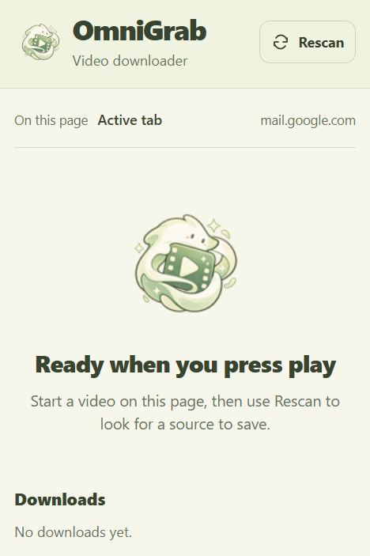

#  OmniGrab

## 📖 Project overview

OmniGrab is a Chrome extension that finds media on the current page and saves supported HLS videos as MP4. It combines network observations, page media elements, Resource Timing, and manifest parsing to identify sources and available qualities.

Downloads run entirely in the browser. The extension preserves the original H.264 video and AAC audio by remuxing them into MP4, without re-encoding or a native companion app.

## ✨ Features

- Detect direct media files, HLS playlists, and DASH manifests.
- Show available qualities, duration, dimensions, and source evidence when available.
- Select a supported HLS quality and edit the output filename.
- Track downloads across popup closure, with cancel, retry, and download-again controls.
- Copy source URLs and inspect technical details on demand.
- Rescan dynamic pages and media inside frames and open shadow roots.

<p align="center">
  
</p>

*Demo screenshot: the popup before a video source has been detected.*

## 📦 Install locally

Requires **Node.js 24+**, **npm**, and **Chrome 120+**.

```powershell
npm.cmd ci
npm.cmd run check
```

On macOS or Linux, use `npm` in place of `npm.cmd`.

1. Open `chrome://extensions` and enable **Developer mode**.
2. Click **Load unpacked** and select the generated `dist` folder.
3. Pin OmniGrab from Chrome's Extensions menu.
4. Reload existing webpage tabs so the content scripts can start.

After changing extension code, run `npm.cmd run build`, reload the extension, and reload the webpage.

## 🚀 How to use

1. Open a video page and start playback so Chrome requests the media.
2. Open OmniGrab. Use **Rescan** if the source has not appeared.
3. For a supported HLS source, choose a quality and edit the `.mp4` filename if needed.
4. Click **Download** and keep the originating page open. You can close the popup and reopen it to check progress or cancel.
5. Wait for **Saved by Chrome**, then find the MP4 in Chrome's downloads. Use **Retry** after a failed attempt, or **Download again** for another copy.

Rescan checks current media elements and resource history and retries failed manifest probes. It does not start playback or force fresh network requests.

## 🎞️ Supported media

Detection and downloading have different coverage:

| Source | Detection | Download support |
| --- | --- | --- |
| Direct files, including MP4 and WebM | Network metadata and loaded media elements | Not implemented |
| HLS (`.m3u8`) | Master/media playlists, qualities, duration, and protection indicators | Supported unprotected VOD with H.264 video and AAC audio |
| DASH (`.mpd`) | Representations, metadata, and segment relationships | Not implemented |
| Blob / Media Source Extensions | Local playback context; remote sources are detected separately | No direct blob/MSE capture |

Live downloading, encrypted/DRM media, arbitrary codecs, and site-specific extraction are unsupported. A detected source can still fail to download because of expired URLs, authentication, CORS, unavailable storage, or unsupported playlist constructs. Exact Video DownloadHelper coverage is not guaranteed.

## 🛠️ Implementation

### 🔍 Detection module

Detection is implemented in this repository; it does not use a third-party video detection SDK.

1. **Collect observations.** [`RequestTracker`](src/background/network.ts) captures request context, response status, MIME type, and byte length through `chrome.webRequest`. [`observeMedia` and `collectResources`](src/content/collector.ts) inspect video/audio elements, source alternatives, dynamic DOM changes, open shadow roots, and Resource Timing entries in each injected frame.
2. **Classify sources.** [`classify`](src/core/classify.ts) combines URL suffixes, MIME types, and loaded media metadata. It filters fragments and unsuccessful responses; blob URLs remain unresolved context. A playlist-looking URL alone is not confirmation.
3. **Merge evidence.** [`ingest`](src/core/reducer.ts) deduplicates observations, tracks tab/frame/document identity, and groups known child playlists and segments under their source. Navigation fences reject stale observations. Signed URL query strings are preserved.
4. **Verify manifests.** [`ManifestProbe`](src/background/manifest-probe.ts) fetches candidate playlists with up to four concurrent probes, a five-second deadline, and a 2 MiB body limit. It can fall back to the originating content-script document under normal page CORS. [`parseHls`](src/manifests/hls.ts) and [`parseDash`](src/manifests/dash.ts) extract variants, duration, protection indicators, and resource relationships. Detection does not fetch encryption keys or download the video segments.
5. **Update the popup.** [`DetectionStore`](src/background/store.ts) persists session snapshots. The [popup controller](src/popup/index.ts) requests the active tab's snapshot and listens to storage changes; [`renderSnapshot`](src/popup/view.ts) renders confirmed remote media, quality controls, and expandable diagnostics.
