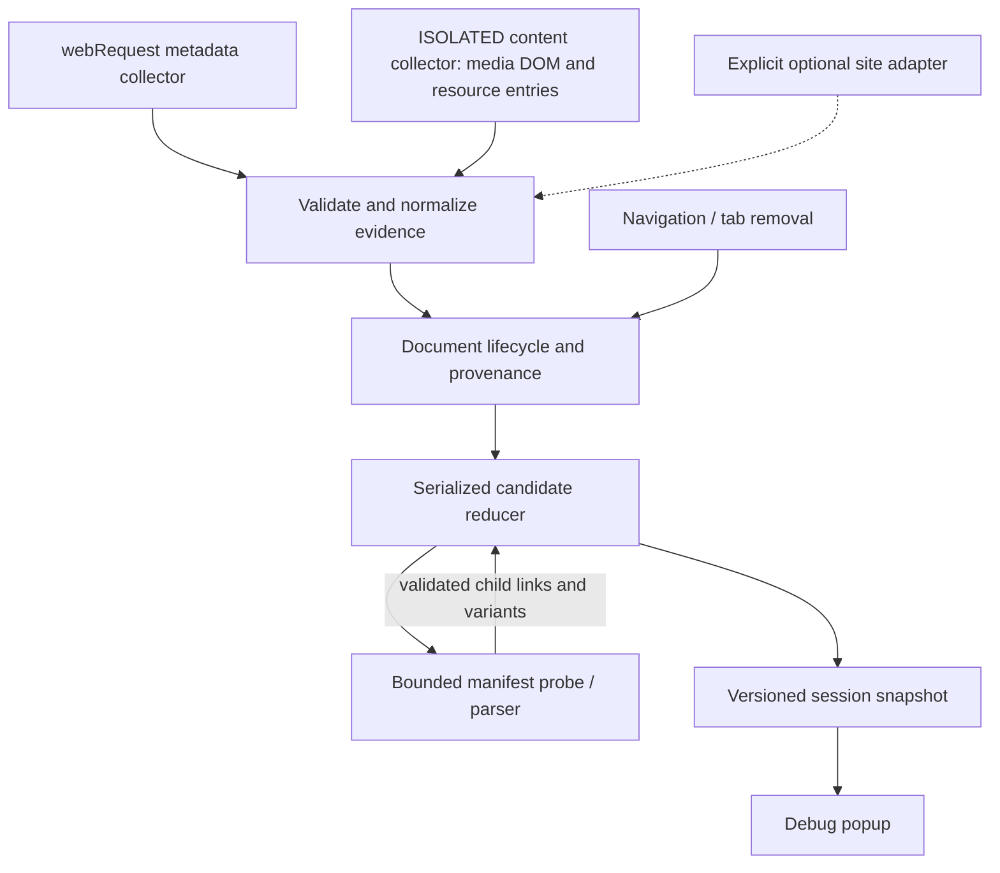

# Proposed detection architecture

Status: **detection milestone implemented and verified on `feat/detection-engine`**. Date: 2026-10-15 (America/Toronto). The goal's Phase 3 authorized this work; measured results, deviations and remaining limits are tracked in [DEVELOPMENT_PROGRESS.md](DEVELOPMENT_PROGRESS.md).

The goal is an original Chrome MV3 TypeScript detection engine with reliable cross-website discovery and a minimal debugging UI. [Research](REA_DETECTION_ANALYSIS.md) informs the design; additional techniques below are proposals rather than claims about Video DownloadHelper. Runtime comparison is required before claiming parity.

## Scope and alternatives

| Approach | Benefit | Limitation | Decision |
| --- | --- | --- | --- |
| Network-only classification | Small surface, sees dynamically requested HTTP media | Misses late/idle DOM sources and weak/opaque network evidence; offers poor page attribution | Useful collector, insufficient as the whole engine. |
| Hybrid network + DOM/resource observations + manifest parsers | Complementary evidence, late discovery, explicit provenance and grouping | More correlation/state work; manifest refetch can fail | **Recommended initial engine.** |
| Global fetch/XHR/MSE interception on every page | Can expose some original manifest responses and page buffers | Intrusive, easy to break players, incomplete and costly; still cannot make protected playback downloadable | Exclude from the generic baseline. Consider narrow, independently tested site adapters only when evidence shows a gap. |

Initial scope includes direct video/audio containers, HLS, DASH, dynamic elements, known manifest variants, tab/frame/document attribution, navigation/restart resilience and diagnostics. The UI lists evidence and outcomes. Download/mux/transcode, account licensing, polished UI, remote code, DRM or access-control bypass, and legacy companion emulation are outside this detection milestone.

## System boundaries and data flow

Collectors report facts; they do not independently create final UI rows. One reducer owns candidate identity, status, deduplication and relationships. Browser-facing wrappers depend on pure TypeScript classification/parser/reducer modules, so fixtures can test behavior without Chrome.

### Module responsibilities

The table describes the design. Implementation combines lifecycle handling into `src/background/index.ts`; there are currently no site adapters. See the progress ledger and browser comparison for implemented and verified scope:

| Module | Single responsibility | Inputs / outputs |
| --- | --- | --- |
| `src/background/index.ts` | Synchronously register Chrome listeners; wire lifecycle/store/collectors | Browser callbacks → validated ingestion calls |
| `src/background/network.ts` | Extract successful response metadata and request provenance; no body assumption | Request details → network observations |
| `src/content/index.ts` | ISOLATED initial/late DOM scan and bounded media/resource observation | DOM/media events → schema-validated messages |
| `src/core/model.ts` | Versioned observation, candidate, variant, provenance and snapshot types | Shared compile-time contracts |
| `src/core/classify.ts` | MIME/URL/context evidence classification and fragment exclusions | Observation → candidate intent or ignored/pending reason |
| `src/core/identity.ts` | Exact URL/document keys and explicit relationship keys | URL + document identity → stable scoped IDs |
| `src/core/reducer.ts` | Pure state transitions, merges, grouping, navigation removal | State + event → next state and bounded work effects |
| `src/background/lifecycle.ts` | Tab/frame/document generation tracking; reject stale results | Navigation + sender metadata → document identity |
| `src/background/store.ts` | Serialize mutations, restore snapshots, expose revisions and persistence failures | Reducer transitions ↔ session storage |
| `src/background/manifest-probe.ts` | Deduplicate and bound refetches; enforce permission/size/time rules | Candidate job → parse result/error with provenance |
| `src/manifests/hls.ts` | Parse HLS master/media playlists and child relationships | Manifest text + final base URL → variants/segments/protection metadata |
| `src/manifests/dash.ts` | Parse MPD representations, adaptations, language and source metadata | MPD text + final base URL → variants/protection metadata |
| `src/content/adapters/` | Optional site-specific extraction behind a typed registry | Verified site metadata → standard observations |
| `src/popup/` | Minimal active-tab snapshot viewer and safe rescan action | Snapshot → media/evidence/status rows |
| `tests/fixtures/`, `tests/` | Original representative fixtures and pure/integration/browser assertions | Cases in test matrix → recorded outcomes |

Adopt small parser libraries only after checking their official interfaces, licenses, browser-worker compatibility and maintenance. Bundle executable dependencies locally. Do not transplant proprietary parsers, hashes, rule lists, website credentials or deobfuscated source into this project.

## Observation and candidate contracts

Each observation records `observationId`, `observedAt`, method (`network`, `dom`, `resource`, `manifest`, or named adapter), raw source URL, optional final response URL, claimed MIME, response status/size/range metadata when actually available, and provenance. Network timestamps and receipt timestamps remain distinct.

Provenance contains trusted browser `tabId`, `frameId`, `documentId` when supplied, a top-document generation, observation origin, and an optional element ID. Sender identifiers are derived from Chrome's message sender, never trusted from page payload fields. Page-provided titles/types are metadata claims, not authority over tab identity or classification.

A candidate contains:

- Stable ID scoped to tab/document generation and exact normalized HTTP(S) URL; byte-significant query parameters are preserved.
- Type: `direct`, `hls`, `dash`, or unresolved `blob`/`unknown`.
- Status: `observed`, `probing`, `confirmed`, `unresolved`, `unsupported`, or `stale`; explicit error/reason codes are separate from type.
- First/last observation times, methods, evidence references and confidence basis.
- Optional MIME, container/codecs, dimensions, duration, byte size, poster/title and protection metadata, each with source provenance.
- Explicit variants, audio/subtitle associations and parent/child URLs obtained from parser or adapter evidence.

Unknown metadata remains unknown. A direct URL can be confirmed as media without proving it can be downloaded. An element's `blob:` or `MediaStream` source is never represented as a reusable remote download URL. A failed manifest refetch preserves the observed manifest candidate with its failure reason.

## Complementary collection techniques

### Network metadata

Register listeners synchronously before any storage restoration awaits. Collect nonblocking response-start/header data for relevant request categories, including XHR/fetch-backed media. Use successful response MIME/status as stronger signals than suffixes. URL patterns can create a pending manifest probe, not an automatic confirmed video. Preserve redirects/final URL as separate evidence. Distinguish total length from a byte-range payload length.

Explicitly recognize direct MP4/WebM and other supported audio/video MIME families, standard HLS/DASH MIME aliases, and extensionless sources. Ignore images/scripts/styles even when names contain `video`, unless independent media/manifest evidence overrides that interpretation. Fragment MIME/URL evidence creates a suppressed child observation; it does not automatically create a standalone downloadable video.

Permission failures or hidden events must be distinguishable from no media. Chrome's host/initiator visibility constraints apply; see [webRequest](https://developer.chrome.com/docs/extensions/reference/api/webRequest). The collector does not capture request bodies, cookies or authorization values for this detection milestone.

### Media DOM and dynamic elements

An ISOLATED collector performs an initial scan of `video`, `audio` and child `source` elements, then observes added nodes and relevant `src`/`type` changes. Media events such as `loadedmetadata`, `loadstart` and `emptied` refresh actual source and metadata. Each element gets a document-local ID; retain alternatives from child sources separately from the currently selected source. Never trigger playback or loading solely to create detections.

Use a MutationObserver with batched work and a per-document bounded seen set. Discover open shadow roots that can be reached through ordinary DOM traversal; closed shadow roots remain unsupported without other evidence. Include newly added nested subtrees without rescanning the entire document on every mutation. Treat blank, invalid, data and blob schemes explicitly rather than coercing them into HTTP URLs.

Related-frame injection uses supported manifest options and an intentional URL scope. `all_frames` alone is insufficient for related opaque-scheme frames; [Chrome content-script documentation](https://developer.chrome.com/docs/extensions/develop/concepts/content-scripts) defines the constraints. Each injected frame reports its own observations; it does not traverse cross-origin parent DOM.

### Late resource observations

Read the current document's Resource Timing inventory and observe new resource entries where supported. This complements a service worker that wakes after initial media loading and URLs exposed only in JS request paths. Resource entries do not expose response bodies and may lack MIME/size detail, especially cross-origin; initiator type or a suggestive path is weak evidence. A generic resource URL is never enough to classify every `.jpg` or extensionless response as video.

### Blob/MSE association

Keep blob-element observations as unresolved context. Associate them with known network/manifest candidates only when evidence justifies a relationship: a common trusted frame/document and an explicit adapter/player link is strong; temporal proximity alone is weak. Do not group every request in a tab under one video. Show ambiguous associations as such. Underlying HLS/DASH discovery works without intercepting MSE buffers, as the current original-extension case suggests; arbitrary MSE/WebRTC buffers remain outside guaranteed coverage.

### Site adapters

Start with the generic path and tests. Add adapters only for demonstrated detection gaps using authorized pages and a typed, versioned interface. Prefer page-visible metadata and public playback configuration over broad network monkey patches. MAIN-world bridges, if later necessary, pass a small validated message through ISOLATED code; page data cannot choose trusted sender/tab IDs or execute code in the service. No downloaded rule/code execution, signature bypass or account/access-control emulation.

## Manifest probing and variant grouping

Initial limits: 5-second fetch deadline, 2 MiB decoded manifest text ceiling, four concurrent probes globally, one in-flight job per exact URL/document generation, and a bounded queue. Check host access and allowed HTTP(S) schemes before fetching. Abort/remove queued work on top-document navigation and tab closure. A result carries the generation that started it and is discarded if that generation is stale.

Resolve relative manifest URLs against the **final response URL**, not blindly against the page. Preserve signed query parameters exactly; do not copy master query parameters onto children without explicit spec/site evidence. Avoid automatic manifest-child fetch fan-out for ordinary discovery: parse the known master, then probe selected/observed children only when needed to determine type or metadata.

HLS parsing recognizes master versus media playlists, rendition/audio/subtitle groups, codecs, dimensions/bandwidth, segment/init/key references and live/VOD markers. A subtitle-only playlist is not a video row. DASH parsing recognizes MPD, periods/adaptations/representations, BaseURL inheritance and major segment descriptor forms; dimensions/codecs/audio language are metadata, not proof that all segment forms are supported for downloading. Reject malformed XML, DTD/entity expansion and oversized/deep input. Protection markers are reported; no decryption or DRM bypass is implemented.

Group variants only through explicit master/representation relationships. An HLS variant ending `.jpg` remains valid if parsed from a confirmed master. Separate unrelated videos sharing a CDN or title. Merge duplicate observations of the same source within one document while retaining all methods. A late master can replace its known child rows with variant links; it must not delete unrelated direct videos based solely on file size or initiator.

## State, concurrency and lifecycle

Persist a versioned per-tab snapshot to `chrome.storage.session`, keeping settings in `storage.local`. Session storage survives service-worker instance suspension, but is cleared on extension reload/update/disable or browser restart; see [storage reference](https://developer.chrome.com/docs/extensions/reference/api/storage). Do not promise cross-browser-restart recovery of detections.

Use one serialized mutation chain: await restoration, apply a reducer event, persist the new revision, then acknowledge/publish it. Events received during restoration queue behind it. Surface failed writes; do not report a persisted revision that never saved. Persist pending probe descriptors so wake-up can recover/retry bounded work; in-memory timers and globals are caches, not the authoritative store. [Chrome lifecycle guidance](https://developer.chrome.com/docs/extensions/develop/concepts/service-workers/lifecycle) requires resilience to unexpected worker termination.

Use browser document IDs where available and a persisted top-document generation as a fallback fence. Top-level commits advance the generation and clear that tab's prior document results. SPA history-state changes preserve/reconcile the document's observations while updating page metadata; a rescan refreshes element evidence and retires superseded element sources. Subframe navigation only invalidates the relevant frame/document. Old asynchronous fetch completions cannot resurrect media after navigation. Tab IDs are never treated as permanent identities across browser sessions.

The [original baseline trials](ORIGINAL_BASELINES.md#navigation-state-observations) observed an old MP4 retained alongside a correct DASH item after a reused-tab navigation; a fresh-tab control had only the MPD. This supports the generation-fence requirement, while the original's exact failure mechanism remains unknown. Tests must inspect source identity, not merely a nonempty tab snapshot.

Bound retained state: at most 200 candidates and 1,000 compact observations per tab, 20 variants per item initially, 50 tab snapshots, and a 30-minute idle retention policy. Evict stale/weak diagnostics first, then oldest inactive candidates, recording truncation counters. Active confirmed sources and parser relationships must not disappear silently. These are proposed defaults to validate with the matrix, not copied original thresholds.

## Permissions and minimal debugging UI

Proposed required API permissions: `webRequest`, `webNavigation`, `storage`. Host permissions are HTTP(S) patterns broad enough for the page **and its media CDN**. This breadth is a real cost of automatic cross-website observation and must be explained in setup; it does not authorize additional data collection. Static content scripts avoid an initial `scripting` permission. Add APIs only if an implemented and reviewed feature needs them.

No initial `downloads`, `offscreen`, `nativeMessaging`, `debugger`, `declarativeNetRequest`, `browsingData`, `notifications`, `unlimitedStorage` or account permissions. Broad `tabs` access is not required merely to query the active tab ID; use DOM-observed title/poster and granted host access where needed. Verify the chosen calls against [Chrome tabs documentation](https://developer.chrome.com/docs/extensions/reference/api/tabs) during implementation. Minimum supported Chrome: 120, stated explicitly in the eventual manifest.

The popup shows the active tab/document and revision, then rows with URL, type, status/reason, methods, known metadata, variants and first/last-seen time. Display exact URL text safely and provide copy controls; do not insert page strings as HTML. A **Rescan** requests a read-only DOM/resource rescan; it does not erase cookies or force playback. Diagnostics expose denied permissions, blocked/failed probes and truncated state. Opening the popup must not make the extension's own page the detection context; determine the actual browser tab on each open.

## Verification and implementation boundary

Follow [DETECTION_TEST_MATRIX.md](DETECTION_TEST_MATRIX.md). Pure fixture tests cover classification/parsing/reducer identity; browser tests cover real Chrome permissions, frames, dynamic DOM, persisted state and popup snapshots. Comparative runs use the same authorized page version, playback actions, timing and cold/warm state for both extensions. Preserve original/new results independently before calculating differences.

Implementation followed the required research pass under the goal's Phase 3 authorization. Production code contains original code and bundled licensed dependencies. REA files/captures remain under `docs/rea-evidence/` and are excluded by the build allowlist. Successful fixtures do not establish cross-website parity.

### Implemented scope and design differences

The implementation uses the declared three API permissions and HTTP(S) hosts. Lifecycle wiring lives in `background/index.ts` with an in-memory token fence; pure snapshot transitions remain in `core/reducer.ts`. Pending manifest work is reconstructed from persisted observed/probing statuses and candidate instances rather than stored as a second global queue. Each owner can retain up to 100 `childManifests` descriptors. Observed children remain eligible; since the Cinejoy repair, a master lacking duration additionally schedules one preferred video rendition (or audio fallback) for metadata. `resolveProbeJob` and physical-fetch ownership aliases preserve an already-running child's work when a master groups it, while document changes fence stale results. Other unobserved renditions, media segments and keys are not fetched for detection. No indefinite worker keepalive is installed.

Worker manifest retrieval is attempted first. Failed HTTP/parsing can use `background/page-manifest.ts` to message an exact current originating frame/document. `content/manifest-fetch.ts` uses an ordinary fetch with normal CORS and default same-origin credentials, under the same absolute probe deadline and two-MiB limit. Trusted extension senders, reply bounds and document identity are validated. Cancel messages abort the underlying content fetch. Physical page-fetch slots remain occupied until the actual reply settles; bounded content-side waiting also covers work surviving a worker restart. Failed probes can be retried by fresh positive network evidence within a three-attempt budget or explicitly reset by Rescan. Routine resource reports and worker recovery do not retry terminal failures. See [the incident report](CINEJOY_DETECTION_FIX.md) for the measured request-context and misleading-MIME cases.

`core/limits.ts` aligns producer and restoration bounds: 16,384 characters per persisted string and 2,097,152 characters of references per parsed manifest. Accepted transitions are validated before saving. Weak candidates are displaced by stronger incoming evidence at the source cap, with explicit eviction diagnostics. Navigation errors reconcile surviving frame bindings through a token-guarded browser lookup. The build includes and audits the XML parser's complete MIT notice.

The snapshot keeps compact source/provenance aggregates rather than a raw observation history. Counts are bounded and quota/save failures are surfaced. There is no 30-minute idle timer or settings layer yet. Prior DOM sources remain previously observed evidence until navigation; element removal does not send a tombstone, and there is no guarantee of immediate removal tracking for detached frame elements. SPA route updates preserve same-document evidence. Live-window rollover and recovery of unclassifiable responses that precede a manifest relationship remain unverified. These limits differ from the broader design targets above and are not claimed as completed matrix coverage.

There are no site adapters or generic MAIN-world/MSE interception. Related-frame declaration is present; only tested frame scenarios establish runtime coverage. Blob rows remain contextual, separate from detected remote sources. XML validation uses `fast-xml-parser`; all dependency code is bundled locally. The [development ledger](DEVELOPMENT_PROGRESS.md) and [browser comparison](BROWSER_COMPARISON.md) record actual commands, reviews, failures and measured outcomes.
