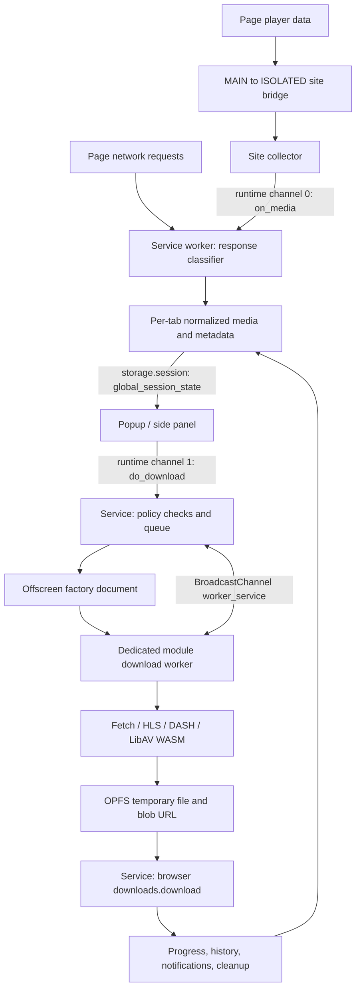

# Video DownloadHelper: installed-extension architecture analysis

Investigation date: 2026-10-15 (America/Toronto). Analysis only; no extension was built, loaded, modified, or used to download media. This report paraphrases behavior and records identifiers; it does not reproduce proprietary implementation code.

This document records the initial static-only pass. Subsequent runtime observations and their separate confidence limits are in [REA_DETECTION_ANALYSIS.md](REA_DETECTION_ANALYSIS.md) and [ORIGINAL_BASELINES.md](ORIGINAL_BASELINES.md).

The 2026-10-23 [Cinejoy investigation](CINEJOY_DETECTION_FIX.md) reinspects installed version 10.6.7.2, explains the HLS-to-MP4 display distinction, and records the separate detector's request-context repair and live verification. The version-specific findings below remain the original static baseline.

The subsequent [download gap analysis](DOWNLOAD_REPLACEMENT_GAPS.md) traces the current package's browser processing/save pipeline and distinguishes the replacement's working detection from its unimplemented downloadable output.

## Target, evidence, and confidence

Requested extension directory:

`C:\Users\jay03\AppData\Local\Google\Chrome\User Data\Default\Extensions\lmjnegcaeklhafolokijcfjliaokphfk`

The directory contained one version, `10.6.1.2_0`. Its manifest identifies **Video Download Helper**, version **10.6.1.2**, Manifest V3. All relative target paths below resolve under that version directory, not under this workspace.

**Verified static** means the declaration or control/data flow was inspected in the installed files. It does not mean the extension executed successfully. **REA static** refers specifically to observations produced by REA. **Hypothesis** identifies an interpretation requiring further evidence. **Unknown** identifies an untested boundary. There was no live Chrome, network, authentication, or download exercise.

The bundles are minified, with very long lines. References use the actual bundle-local function names, a 1-based line, and a **0-based decoded-text character offset** where useful. Offsets count the text after universal-newline normalization. A named function is a navigation aid, not a recovered original source name. Async references may point at `function` after the `async ` prefix.

Selected SHA-256 fingerprints of the original bytes:

| File | Bytes | SHA-256 |
| --- | ---: | --- |
| `manifest.json` | 6,591 | `4ae041e90dede7b5b6e2d0e4b15f947fd3392551998e707d89de7c6c0da7039e` |
| `service/main.js` | 555,942 | `3c55d99b3b3f8944d735df8dd57e5a9584ec5dfcd45702a2d94fbff667ca0edd` |
| `content/panel.js` | 356,725 | `ddc7c9d1f7badd5a915c98e66c9a2835904df087cf374c18c15d177a84ea559e` |
| `factory/factory.js` | 11,452 | `6aa91164b4f7ba505dc883c14e058111a6de70c688f3519e49056f8cf6d2a794` |
| `download_worker/main.js` | 172,174 | `1a9267898f705a115adf53abb9c08c4a1db9eae54d9a2e7675eb23d57d9083e6` |
| `download_worker/libav-6.5.7.1-h264-aac-mp3.wasm.wasm` | 4,857,858 | `85ead7c04975d76338581122d0b596ff7f38a1c1d05fa56bb8bcfd4428ffd47f` |

## REA method, results, and limitations

The configured REA MCP tools were not exposed in the chat's tool catalog. A temporary stdio MCP client connected to the existing installed **REA 6.5.0** public launcher instead; this was an actual MCP `initialize` / `tools/list` / `tools/call` session, not a substitute source-text search labeled as REA. No REA or Chrome configuration was changed. The first analyzer attempt failed its Windows isolation self-test with access denied; rerunning the MCP harness with the authorized filesystem/process access succeeded. No extension JavaScript was executed.

`analyze_javascript_application` analyzed the installed directory with these exact selected source paths: `manifest.json`, `service/main.js`, `content/panel.js`, `content/global_persistent.js`, `content/register_components.js`, `content/popup.html`, `factory/factory.js`, `factory/factory.html`, `download_worker/main.js`, `injected/vimeo.js`, `injected/vimeo_untrusted.js`, and `injected/kick.js`. Source selection bounds semantic work; direct inspection additionally covered the Facebook collector and LibAV glue. Settings were `detail: summary`, `max_heap_mb: 2048`, and a 120,000 ms per-source deadline, with default semantic node ceilings.

REA identified the directory with artifact digest `97cf7b9ec9c8ccd1cb7bd5d886046477ac69d2358585a027856fc96e156c4dbc`. This is REA's artifact identity, not the digest of a concatenation invented for this report. It read 2,490,844 text bytes, parsed nine JavaScript files, visited 485,094 AST nodes, and reported zero parse failures. It retained static module/worker, syntax, and relationship candidates. Its Electron-specific zero counts are not evidence that Chrome-extension messaging is absent.

| REA operation | Evidence ID | Result |
| --- | --- | --- |
| Parent application analysis | `ev_adeedde8b1f85a04fa3f9d8bffa75f260df223eb99234c7cff184d91d9377b05` | Partial application and semantic graph. |
| Summary projection | `ev_26c539c27679cf0b6cc1de5b8117b36a98778bd6c1d96bf4401a186626c1a2ee` | Complete within the requested summary view; parent coverage remains partial. |
| Incoming exact string trace: `on_media` | `ev_5730f0062bfe263dc788436a1d3844bfb7a570c4b5d2c46aabf67c00138325bd` | No matched graph seeds. |
| Incoming exact string trace: `do_download` | `ev_f2701faf3094c7c1b5a6b52c2c0220da8ed0da35141b4844c150c72e23113936` | No matched graph seeds. |
| Incoming exact string trace: `global_session_state` | `ev_5d1218c2cdb03130c5bd81ee6eee19c57d3ca56679c5b6600fff332cfdc96083` | No matched graph seeds. |
| Outgoing exact module trace: `factory/factory.js` | `ev_22489b1ede73a90a407c1fe981de79442743548d194d6409cbb68cd5b35f8fe8` | Two seed roles, three nodes, two edges; includes inferred module-to-worker `loads` relationship. Worker target expression remains unresolved by REA. |

**Coverage matters:** 62 inventoried files were outside selected source analysis. Semantic coverage hit the default 20,000-node per-file and 100,000-node application ceilings and reports 72,936 semantic unknowns. The application graph also records 62 unknowns. These are analyzer coverage records, not counts of application defects. The three string trace results explicitly say unmatched seeds are not evidence of feature absence. The message/storage literals and their implementations are visible in the installed files, so the report's detailed Chrome messaging, request-classification, storage, and format-processing conclusions are attributed to **direct static inspection**, not to successful end-to-end REA feature traces.

REA's module page distinguishes asset and module graph roles for the same path; file-path equality alone is insufficient to select a module item. Selected item views are `ev_f0365e1299dabbc6111a4b8cd2f31723c3378230bab72dd448b0ff6fd318be4d` (service source-module), `ev_1a00402469ab22f802feffca64fb4e18b09423a3e7bd92a3f235caf26dacd323` (panel source-module), and `ev_505c1b82c9621421feba8ae6949b01e312a7ad18f4d924f908c4de1a94c5ad57` (worker **unresolved dynamic-import reference**, not the worker's entire source module). The worker item records a dynamic import without resolving its specifier. Direct inspection resolves the factory URL and LibAV selection; REA alone does not establish those endpoints.

The initial canonical evidence bundle was exported to `C:\Users\jay03\AppData\Local\Temp\vdh-rea-20261015\evidence-bundle.json` for local follow-up. It is a temporary forensic artifact, approximately 200 MB, and is not included in this workspace. The later module views and factory trace reused that bundle through `import_evidence_bundle`, without repeating source analysis. Portable [summary](rea-evidence/application-summary.json), [feature-trace](rea-evidence/feature-traces.json), and [module-item](rea-evidence/module-items.json) receipts accompany this report. They retain static metadata, short syntax observations, evidence IDs and coverage; they do not include copies of the extension bundles or a new implementation.

## Architectural overview

**Verified static:** the service worker owns detection, tab association, settings, shared application state, and download coordination. Site collectors supplement generic network observation. The popup/side panel renders a serialized snapshot from extension storage. An offscreen document hosts a dedicated download worker, which fetches or processes media, writes temporary files in the origin private file system (OPFS), and produces a blob URL. The service then hands that blob URL to the browser Downloads API.

The diagram combines statically inspected paths; it is not a runtime capture. Page bridges apply to paired site scripts, not every website.

## Manifest V3 configuration and entry points

Source: `manifest.json` (entire declaration inspected).

| Surface | Declaration / verified responsibility |
| --- | --- |
| Background | `service/main.js`, `type: module`; startup `Hx()` restores state and installs operational listeners. |
| Toolbar action | Icon/title declared, **no manifest `default_popup`**. Service `$b()` selects popup or side-panel behavior at runtime. |
| Popup | `/content/popup.html`, selected by service code; loads module `panel.js`. |
| Side panel | Manifest `side_panel.default_path: /content/sidebar.html`; shares panel logic. |
| Commands | `_execute_action`: Alt+Up; `default-action`: Alt+Down. macOS alternatives are Ctrl+Shift+Up/Down. Service `Cb()` constructs the selected action for the active tab. |
| Offscreen host | Not a manifest background page: service `pv()` creates `/factory/factory.html` with reason `WORKERS`; its script starts `/download_worker/main.js` as a module Worker. |
| CSP | Extension pages specify `script-src 'self' 'wasm-unsafe-eval'`, consistent with bundled WASM processing. |
| Other UI assets | History, details, smart naming, shared component/persistent-state bundles. A `content/` directory name does not make these page content scripts. |

Declared host access is `<all_urls>`. Required permissions are exactly:

| Permission | Relationship to inspected architecture |
| --- | --- |
| `webRequest` | Observe sent headers and response-start events for detection. |
| `webNavigation`, `tabs` | Associate media with tabs, track active tab, refresh metadata, clear discoveries on top-level navigation/removal. |
| `scripting` | Execute title/thumbnail and naming selectors in page context; inspect video `mediaKeys`. |
| `declarativeNetRequest` | Temporary session rules restore selected request headers for extension fetches. |
| `offscreen` | Create the worker-hosting factory document. |
| `downloads` | Save finished blobs, monitor completion, manage download records. |
| `storage` | Session media/progress state and persistent settings/history. |
| `unlimitedStorage` | Declared alongside OPFS/storage use; actual quota behavior was not exercised. |
| `sidePanel` | Panel configuration/opening. |
| `notifications`, `contextMenus` | Completion notifications and action/context-menu UI. |

Optional permissions are `browsingData` and `downloads.open`; declaration does not establish that either was granted. There is **no `nativeMessaging` permission**, `webRequestBlocking` permission, manifest options page, or `web_accessible_resources` declaration in this manifest.

All listed site media scripts use `all_frames: true`. Vimeo runs at `document_start` in paired ISOLATED/MAIN worlds. YouTube, IQ, and Bilibili have paired ISOLATED/MAIN scripts at `document_end`; xgplayer_crypto and javrank have pairs at `document_start`. Facebook/Instagram, OK, VK/VKVideo, Canva, TwitCasting, Osmosis, Kick, and Chaturbate have ISOLATED collectors at `document_end`. Taiav uses MAIN at `document_end`. Separate activation/premium page scripts are restricted to the declared DownloadHelper URL patterns. There is **no generic `<all_urls>` content-script entry**; generic detection comes from service-worker network observation.

## Service worker and injected-script responsibilities

### Generic detection and classification

**Verified static**, `service/main.js`:

1. `If()` registers `webRequest.onSendHeaders` and `onResponseStarted` across `<all_urls>` for `xmlhttprequest`, `media`, `main_frame`, `sub_frame`, and `other`. Sent headers are cached by request ID. Opportunistic cleanup uses a ten-minute age threshold. Chrome uses `extraHeaders` in addition to ordinary header access.
2. `NS()` accepts HTTP 2xx responses. It rejects blocked initiators, extension-origin/non-HTTP initiators, and resource paths ending in `.ts`, `.m4s`, or `.m2ts` to avoid treating individual stream fragments as independent videos.
3. Before generic site exclusions, special Vimeo player `/config` and IQ `/dash` responses can be refetched as JSON and forwarded to their injected collectors by `zf()`/`fp()`.
4. Generic handling skips initiator domains in `PS`, including YouTube, Instagram, OK, VK, Canva, IQ, Vimeo, Kick, and Javrank. Specialized collectors cover such cases. This exclusion is based on the initiator, not merely the requested CDN hostname.
5. HLS is attempted first for a `mpegurl` MIME match, an `hls`/`m3u8` URL match, or `/api/playlist/master/`. A site rule can try a `.mpd` URL rewritten to `.m3u8`. DASH is then attempted for MIME containing `dash` or URL containing `.mpd`. These are **candidate heuristics**; fetched-manifest parsing determines acceptance.
6. Otherwise a browser `media` request or a recognized MIME subtype goes to `OS()` for direct media classification. `Pf()` maps supported MIME subtypes; `$S()` combines URL basename, Content-Disposition filename, MIME, and supported extension/demuxer rules.
7. `OS()` suppresses known sizes below 500,000 bytes unless a site rule allows small media. It obtains total size from Content-Range where available and records byte-range support. After a DASH detection for the same initiator, unknown-size or smaller direct requests are suppressed below 20,000,000 bytes. These thresholds reduce noise but can also exclude legitimate small files.

The service refetches manifests using captured request context; it does **not** recover original response bodies from `webRequest`. `Eu()` reconstructs captured request headers. `wt()`/`ao()` install DNR header rules, and `St()` removes them. `Wm()`, `Km()`, and `Zs()` split/filter browser-controlled headers. Header replay is present in the code; successful cookies, signed URLs, redirects, CORS, and server authorization remain untested.

Per-site behavior is configuration-dependent. `Dt()` and wrappers such as `_o()`, `oe()`, `Xs()`, `ap()`, and `lp()` consult `remote_behaviours.websites` for detection blocking, query propagation/stripping, duplicate filtering, and small-file allowances. This report establishes those branches, not the current effective rules for every site.

### Normalization, deduplication, and metadata

Detectors emit an internal `on_media` event through `At()`. Injected collectors send a serialized `on_media` envelope through runtime **channel 0**; `gp()` receives it and uses the sender's tab ID. Both paths converge on `rm()`.

Normalized media variants include `http_playlist`, `m3u8`, `m3u8_playlist`, `mpd_playlist`, and a site-specific `youtube_format`. Shared fields include media hash, initiator, captured headers, discovery timestamp, optional title/thumbnail/filename, duration, DRM flag, and cache policy. Playlist entries carry quality/demuxer information and either video/audio URLs or DASH representation/audio identifiers.

`rm()` stores `discovered: Map<tabId, {meta, media: Map<hash, media>}>`. Existing hashes are ignored. `Vy()` applies site/count filters and suppresses a child HLS URL already represented by a master. `Vx()` removes matching child entries when a master arrives and can remove redundant direct requests when DASH arrives. HLS master hashes include manifest text plus URL, DASH hashes use manifest text, and generic direct media hashes use URL. Hash equality is a local deduplication mechanism, not proof that different URLs contain identical bytes.

`jn()` obtains tab URL/favicon/incognito state, smart-naming rules, title, and thumbnail. `Of()` executes DOM queries for video posters, image metadata, and document/meta titles. Active-tab tracking chooses which discovery map the panel displays. Top-level `onBeforeNavigate` and tab removal clear the tab's discoveries; tab updates and DOMContentLoaded refresh metadata.

State writers `ke()`/`ge()` mutate the in-memory session state, with `ke()` scheduling a write after 500 ms and `ge()` flushing immediately. `Pb()` serializes to `storage.session.global_session_state`; settings/history use `storage.local.global_persistent_state`. On session quota failure, the code resets discoveries while preserving active-tab and downloading state. Startup restores state and clears stale downloading entries; continuous survival across all MV3 suspension/restart scenarios was not tested.

### Representative site collectors and bridges

**Verified static examples**, not exhaustive coverage of every injected bundle:

| Site / file | Responsibility |
| --- | --- |
| `injected/vimeo_untrusted.js` | MAIN-world `u()` polls `window.playerConfig`; exchanges messages on a URL-hashed `BroadcastChannel` with channels 4/5. This file exposes player config; no XHR monkey patch was observed in it. |
| `injected/vimeo.js` | ISOLATED `Q_()` reads config metadata/HLS CDN/text tracks, fetches/parses master variants and duration, then sends normalized `m3u8_playlist` on channel 0 through `sl()`. `ll()` also accepts service-supplied config on channel 7. |
| `injected/facebook.js` | `Wh()` monitors URL changes; `Kh()` fetches page HTML with same-origin credentials and extracts embedded DASH manifest fields. `T_()` parses representation choices. The manifest can be retained as an encoded `data:text/plain` master URL. |
| `injected/kick.js` | `Ge()` resolves channel/video/clip API metadata and playback URLs, tries master HLS parsing then media-playlist fallback. Route/link MutationObservers and an ID set support SPA discovery and deduplication. |

Some collectors initialize `has_drm: false`. That assignment is verified; it does not prove arbitrary content from those sites is DRM-free. Other injected adapters and the service's QuickJS WASM-backed `qjs` request path were inventoried or located but not exhaustively reverse engineered.

## MP4, HLS, and DASH handling

### Direct HTTP / MP4

MP4 is a container choice, not a unique network-detection API. Generic direct media becomes `http_playlist`, often a one-entry playlist with unknown resolution/bitrate and known or unknown byte size. Captured Content-Range/Accept-Ranges affects preview and processing choices.

UI/service strategy builders choose direct byte transfer, one-input processing, separate video/audio inputs, or audio extraction. Worker `Ur()` streams fetch chunks directly into OPFS for an ordinary direct download. `kr()`/`Or()` route processing through LibAV/FFmpeg, generally using stream copy; `Lr()` encodes extracted audio with `libmp3lame`. MP4 is the default preferred output muxer in the inspected defaults, while the direct path can preserve an original supported extension. The code does **not** establish universal video transcoding for every MP4 download.

### HLS

`Ef()` refetches the candidate manifest and first tries `Lm()` as a master playlist. It resolves variant URLs relative to the master, records resolution/bandwidth, interprets codec/demuxer choices, selects audio renditions by language/default preference, and applies query propagation/stripping rules. PQ VIDEO-RANGE variants are skipped in this parser. `Vm()` extracts subtitle entries; `Af()` probes a child playlist for duration/protection.

If master parsing fails, `Dr()` plus `ro()` validates an individual media playlist with nonempty segments and rejects all-subtitle playlists. Accepted masters become `m3u8_playlist`; accepted individual playlists become `m3u8`. `io()` estimates duration from segment durations and can label a recent program-date-time playlist `live`; this is a heuristic, not a complete live-stream classification proof. `no()` checks the parser's `contentProtection` field.

Download strategies include `m3u8_audio_video_one_source`, `m3u8_audio_video_two_sources`, `m3u8_audio_only`, and preview variants. There are two implemented processing paths:

- **LibAV jsfetch path:** worker `Ti()`/`Di()` use HLS input(s), explicit audio/video mapping, stream-copy output, optional subtitle handling, and timestamp normalization. `Si()` produces MP3 audio. Service `ru()` sets HLS `will_use_jsfetch` to the inverse of `carry_get_params`; do not assume the manual path handles every HLS download.
- **Manual segment path:** worker `oe()` parses media segments, resolves relative URLs, optionally carries query parameters, and handles media sequence, initialization maps, byte ranges, and AES-128 key/IV fields. `Ft()`/`pn()` fetch segments; `Ir()` decrypts ordinary AES-CBC segments using WebCrypto. `Dr()` and the `Vr()`/`Rr()`/`Mr()` pipelines demux packets and mux output through LibAV. The code includes limited parallel fetching, retries, timestamp repair, and live-playlist refresh/deduplication.

Ordinary HLS AES-128 processing is distinct from DRM circumvention. The inspected download coordinator blocks media already marked `has_drm`; complete encryption or DRM detection coverage was not established.

### DASH

`IS()` refetches MPD XML, calls `Df()`/`ES()`, extracts representation quality/codec data and preferred audio language/track, then emits `mpd_playlist`. The bundled parser handles MPD periods, BaseURL inheritance, SegmentTemplate/Timeline, SegmentList, and SegmentBase syntax. `zS()` inspects playlist `contentProtection`; `kf()` extracts supported subtitle IDs. Parser syntax support does not establish every manifest successfully downloads.

The selected representation is retained as an `entry` index with optional audio track ID. Builders `Vv()` (service) / `kg()` (panel) create `mpd_audio_video_one_source`, `mpd_audio_only`, or preview arguments against the master URL. Worker `fr()` invokes the DASH demuxer through `jsfetch:` with `mpd_video_idx` and maps selected audio by ID; audio/video are normally copied into the chosen container. `pr()` encodes audio-only MP3, and `_r()` handles preview output. Exact demuxer behavior is inside WASM and was not independently decompiled or executed.

## Popup receives, processes, and displays media

**Verified static:** detected-media lists are delivered primarily through **extension storage**, not a runtime port carrying every media item.

1. `popup.html` declares popup mode, hosts `com-main`, settings/toolbar components and templates, and loads `panel.js` (line 14060). That bundle includes its own component registration and persistent-state logic; it does not need to import the similarly named standalone bundles.
2. Startup initializes a default state, awaits `Ki()` reading `storage.session.global_session_state`, and subscribes with `_c()`/`lc()` to session-storage changes. `me()` deserializes tagged Maps, Sets, URLs, Headers, options and other structured values. Persistent settings are loaded separately by `Ac()`/`Yt()`/`uc()` from local storage and trigger `persistent-changed` DOM events.
3. Main class `ee.onStateChanged()` selects `current_win_tab.tab_id`, retrieves its discoveries/metadata, joins active downloads and transient history by media hash, reconciles `com-media` rows, and removes stale rows. It also displays active downloads from other tabs and the last ten transient-history items.
4. Sorting supports newest, oldest, and SMART comparison. The quality selector honors a saved preferred entry or preferred quality/demuxer ordering. Rows display title/thumbnail, quality/demuxer/bitrate choices, known size/duration or live state, subtitles indication, progress, and completed/downloadable state as applicable. Base component `L` uses HTML templates and Shadow DOM.
5. `J.buildArgs()` applies smart naming, edited filename, output/action settings, and selected variant. `J.doDownload()` separately serializes download arguments, media, and tab metadata and sends `do_download` via `P()` in runtime **channel 1**. Quality selection sends `update_media_preferred_entry` to the service.

Previews use a separate path: the UI sends `request_preview`; service `Cf()` creates a short preview through the processing worker and replies on runtime **channel 6** with `on_preview_available` plus an OPFS filename. Preview component `ht` opens that file, creates a local object URL and assigns it to video. `on_no_preview` clears loading. Direct-media previews require byte-range support in the service check; previews also obey site-disable rules. Mouse enter can activate and mouse leave pauses; popup startup can activate the first preview.

## Download initiation, processing, and completion

**Verified static end-to-end sequence:**

1. UI `do_download`, or service default-action `Cb()`, reaches `Hy()`. It deserializes the arguments, checks duplicate active/completed hashes, terms acceptance, platform/entitlement restrictions, and known DRM. It creates a queued download in shared state.
2. Queue class `In` controls total and YouTube-specific concurrency/delay. Defaults include six concurrent downloads; actual settings can override them. Cancellation first tries to remove a pending task, then sends worker abort for a running task.
3. `iu()` waits for its queued task to run `ru()`. `ru()` prepares header session rules and format strategy, and `Hn()` ensures worker readiness. `pv()` creates the offscreen factory document for this Chrome build; `factory.js` verifies extension identity before creating the module worker.
4. Service and worker communicate over `BroadcastChannel("worker_service")`: channels **2** (service to worker) and **3** (worker to service). Commands include download, readiness, abort and blob revocation; results include progress/result/error. Worker `No()` maintains AbortControllers and dispatches strategies through `Mo()`.
5. Worker `L()` writes an OPFS file through a synchronous access handle. Direct HTTP streams bytes; HLS/DASH or remux/extraction use the selected strategies and bundled LibAV. `U()` initializes LibAV with `noworker: true`, connects its writer, invokes FFmpeg, polls progress, and supports interruption/partial results. The outer worker already provides the dedicated thread.
6. Worker `Q()` creates a blob URL for the output file; the strategy returns that URL, its internal filename and ending reason. `iu()` uses the extension already present in the download arguments and calls `downloads.download` with that **blob URL**, the derived filename/subdirectory, `conflictAction: uniquify`, and the selected Save As flag. The final browser call is not necessarily a direct CDN download URL.
7. `Jv()` observes browser download state via search/events; `Kv()`/`tu()` support filename determination. The service removes the OPFS temporary file and asks the worker to revoke the blob URL after the browser stage. Completion/partial/error outcomes update session progress/history, persistent history as configured, and optional notifications. Partial/interrupted output is represented explicitly; success must not be inferred merely from a worker returning a file.

Worker progress is throttled, and the service estimates bitrate from fetched-byte deltas. Abort interrupts processing; not all aborts discard already downloaded partial data. Startup also purges leftover OPFS files and clears stale downloading state.

The LibAV module wrapper connects its `jsfetch:` protocol to JavaScript fetching, URL mutation and Range handling. Worker `ar()` installs `FetchWithRetry = Ki`, providing timeout/retry behavior. The bundle imports `libav-6.5.7.1-h264-aac-mp3.wasm.mjs` with its sibling WASM. A separate service `emscripten-module.wasm` participates in the QuickJS path; it is not evidence that the service itself performs the main media muxing.

**Bounded negative finding:** this manifest lacks `nativeMessaging`; no `connectNative` call or companion string was found in the inspected service bundle. Its `sendNativeMessage` string is in generic polyfill API metadata. The verified download path for this version is browser/offscreen/OPFS/WASM. This does not establish that no other version used a companion application, or whether one is installed on this machine.

## Function and file reference index

These anchors accompany the sections above. Offsets are version-specific; verify the fingerprint before reusing them. `async ` is omitted from some function anchors.

| Area | Target file | Symbols and locations |
| --- | --- | --- |
| Network listeners/classifier | `service/main.js` | `If` L24 @243646; `NS` L24 @242224; `Eu` preceding `Ef`; `PS` preceding `Eu` |
| HLS detection/parsing | `service/main.js` | `Ef` L24 @238208; `Lm` L18 @181129; `Dr` @180219; `ro` @180406; `io` @180881; `no` @183197 |
| DASH detection/parsing | `service/main.js` | `IS` L24 @239407; `Df` @235336; `ES` @235418; `zS` @237153 |
| Direct classification | `service/main.js` | `Pf` L24 @240185; `$S` @240564; `OS` @241129 |
| Discovery/metadata | `service/main.js` | `Vy` L52 @536078; `Vx` @536684; `rm` @537769; `jn` @535479; `Of` L24 @244334 |
| State persistence | `service/main.js` | `x_` L52 @501079; `ke` @501817; `ge` @501990; `Pb` @502101 |
| Internal/runtime dispatch | `service/main.js` | `At` L24 @214104; `gp` @214863; `Er` @215045; startup `Hx` near end of file |
| Header replay | `service/main.js` | `wt` L18 @185440; `ao` @185490; `St` @186002; `Wm`/`Km`/`Zs` immediately following |
| Worker setup | `service/main.js`, `factory/factory.js` | `pv` L15 @148604; `Hn` @148958; factory `D` and `new Worker` on L1 |
| Download control | `service/main.js` | `kt` L24 @210229; `ru` @212221; `iu` @212900; `In` L52 @505465; `Hy` @539451; `Rb` @504546 |
| Popup selection/preview | `service/main.js` | `$b` L52 @503600; `Cf` L24 after `Rf`; `Mf` preview cleanup |
| UI storage | `content/panel.js` | `Ki` L34 @284318; `_c` @284811; `Ac` L48 @353797; startup @354461 |
| UI rows/actions | `content/panel.js` | `ee` L48 @347453; `onStateChanged` @348654; `J` @332269; `doDownload` @335413; `buildArgs` @337292 |
| UI strategies | `content/panel.js` | `kg` L48 @324645; `xg` @327655; `Sg` @329403; `$g` @330172; `eu` @331846 |
| Site examples | `injected/vimeo.js`, `vimeo_untrusted.js`, `facebook.js`, `kick.js` | Vimeo `Q_` L37 @309850; MAIN bridge `u` L1 @1063; Facebook `Kh` L38 @374027; Kick `Ge` L10 @56894 |
| Worker transport/output | `download_worker/main.js` | `ie` L6 @37851; `sr` @37929; `L` @39796; `Q` @40431; `U` @41634; `Mo` L21 @170151; `No` @171466 |
| HTTP worker | `download_worker/main.js` | `kr` L9 @96878; `Or` @97069; `Lr` @97321; `Ce` @97766; `Ur` @98547 |
| HLS worker | `download_worker/main.js` | `Ir` L9 @79446; `Ft` @81454; `pn` @82123; `Dr` @82861; `oe` @84291; `Rr` @88139; `Vr` @91227; `Mr` @93500; `Si` L21 @168563; `Ti` @168773; `Di` @169322 |
| DASH worker | `download_worker/main.js` | `fr` L6 @48416; `pr` @49251; `_r` @49667 |

## Hypotheses, unknowns, and verification boundaries

| Item | Status / interpretation |
| --- | --- |
| Fragment/size filters and master-child deduplication reduce duplicate UI rows | **Inference** about purpose; the filters/removals themselves are verified. They may produce false negatives. |
| Offscreen worker separates processing lifetime from popup lifetime | **Architectural inference** supported by construction and independent channels; resilience to actual MV3 suspension requires a runtime test. |
| Generic detection works on any particular website | **Unknown** without request samples and effective site rules. MIME/URL heuristics and specialized exclusions are verified. |
| Authentication/header replay works for all sites | **Unknown**. Captured headers and DNR replay are verified; real server/session behavior is not. |
| Complete codec, HLS/DASH, DRM or encryption support | **Unknown**. JS dispatch/parser paths and FFmpeg arguments were inspected; WASM internals and all protocol variants were not. |
| YouTube media can actually be downloaded in this Chrome build | **Not established**. Collector artifacts exist, but `ht = google` and `Hy` contain platform restrictions with an experiment/Brave-dependent exception. |
| Malicious-page resilience of MAIN/ISOLATED bridges | **Not audited**. Channel routing was traced; no claim of complete input validation or security isolation follows. |
| Runtime timing, UI appearance, bandwidth, saving, cancellation and restart recovery | **Not exercised**. No live Chrome UI or network capture was collected. |

The six requested areas are answered at static-code level: manifest/entry points, background/content responsibilities, detection/classification, MP4/HLS/DASH handling, popup state/rendering, and download lifecycle. Runtime behavior and exact WASM internals remain explicit gaps.

To extend verification later, use authorized test pages with one known direct MP4, HLS master plus separate audio, and a clear DASH MPD. Observe detector output, storage snapshots, chosen strategy, worker progress, final file streams/duration, cancellation, and offscreen/service-worker restart behavior. That would be new runtime work; it was not performed in this analysis.
