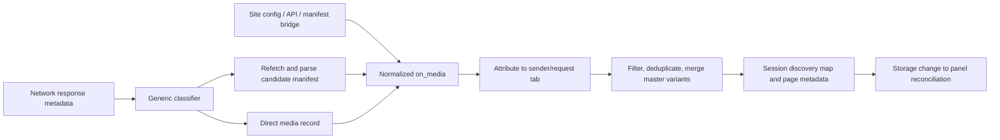

# Video DownloadHelper detection investigation

Date: 2026-10-15. Target: Chrome extension `lmjnegcaeklhafolokijcfjliaokphfk`, version `10.6.1.2`. This is research, not a claim of exact replication.

## Scope and evidence vocabulary

The active objective prioritizes cross-website detection, followed by an original TypeScript engine and comparative tests. The earlier [architectural report](REA_ANALYSIS.md) covers service/UI/download internals. This report adds test-profile verification, detection-specific static inspection, and bounded runtime evidence.

- **Verified static:** a declaration, function or data flow inspected in installed files. Execution is not implied.
- **Verified runtime, REA:** an observation in a named REA Evidence record, subject to that record's coverage.
- **Verified runtime, supplemental CDP:** direct read-only inspection of the selected browser page or original extension; it is explicitly not REA Evidence.
- **Inference:** a supported explanation that exceeds a directly observed edge.
- **Unknown:** evidence is absent, incomplete, or too weak for the claim.

Offsets below are zero-based decoded-text character offsets, with universal-newline normalization. They refer to the installed bundles, not to code in this repository. No proprietary extension bundle is included in production code.

## Target verification and REA coverage

The test-profile extension was located at:

`%TEMP%\rea-video-test\Default\Extensions\lmjnegcaeklhafolokijcfjliaokphfk\10.6.1.2_0`

Its manifest name/version match the Default-profile target investigated earlier. All **81 files** in the earlier target were compared by SHA-256 against corresponding test-profile files and matched. See [identity receipt](rea-evidence/runtime/test-profile-identity.json). This supports reusing the previous static evidence for the test-profile bytes. It does not authenticate the publisher or establish that a file executed.

REA 6.5.0 was used through actual stdio MCP calls because its configured tools were absent from this chat's direct catalog. Static parent Evidence is `ev_adeedde8b1f85a04fa3f9d8bffa75f260df223eb99234c7cff184d91d9377b05`; [summary](rea-evidence/application-summary.json), [feature traces](rea-evidence/feature-traces.json), and [module views](rea-evidence/module-items.json) preserve results. Nine selected JavaScript files parsed without parse failures. Graph coverage is partial: selected-source omissions and semantic ceilings remain explicit. The original message/storage string traces returned no graph match despite literals being visible in the files. The factory-module trace found a worker-load candidate but did not resolve its dynamic URL. These limitations are why the Chrome-specific pipeline below also uses direct inspection.

## Detection pipeline

### 1. Network acquisition and classification

**Verified static:** service `If()` @243646 subscribes to `onSendHeaders` and `onResponseStarted`, covering XHR, media, main/sub-frame and other request categories. Header observations are correlated by request ID. `NS()` @242224 accepts successful responses, applies initiator/site exclusions, rejects common segment suffixes, then attempts HLS, DASH or direct classification.

HLS candidate signals include MIME containing `mpegurl`, URL text containing `hls`/`m3u8`, and a playlist endpoint pattern. DASH signals include MIME containing `dash` or `.mpd` in the URL. A special configuration rule can try an MPD-to-HLS URL conversion. These signals trigger parsing; a filename does not prove format.

The service cannot read the original response body from the webRequest event. `Ef()` @238208 and `IS()` @239407 perform separate fetches with request context and temporary DNR header rules. `Pf()` @240185 recognizes direct-media MIME subtypes. `OS()` @241129 builds an HTTP media record using MIME, URL/Content-Disposition naming, total size and byte-range support. Direct WebM is supported by the MIME/demuxer tables as well as MP4 and other containers.

**Limits:** a separate fetch may expire, receive different bytes, lack a required cookie/header context, or fail permission/server checks. Some format-looking URLs are false candidates. Broad network access does not guarantee observability of browser cache, page service-worker synthetic responses, WebTransport payloads or MSE buffers. Chrome requires host access to both a subresource and its initiator. The supported API exposes response metadata rather than a response-body API. See [Chrome webRequest reference](https://developer.chrome.com/docs/extensions/reference/api/webRequest).

### 2. Site collectors complement generic detection

The manifest declares site-specific collectors, not a generic all-sites video-element scanner. Some sites are excluded from generic handling by initiator domain because their collector handles config/API data. MAIN-world scripts read page globals or intercept selected manifest requests; ISOLATED scripts communicate with the service using runtime channel 0. The service can also refetch Vimeo/IQ config and send it to collectors on channel 7.

All 23 installed `injected/*.js` files were swept for selectors, observers, player globals, network interception and entry-point behavior:

| Site | Verified collection mechanism | File/function anchors |
| --- | --- | --- |
| Vimeo | MAIN polls `window.playerConfig`; ISOLATED fetches/parses HLS and text tracks from config. | `vimeo_untrusted.js::u` @1057; `vimeo.js::Q_` @309850 |
| IQ | MAIN polls `window.__playerdata__`; collector parses embedded player/HLS data and accepts service config. | `iq_untrusted.js::c` @936; `iq.js::tt` @52131, `at` @53427 |
| Facebook | Poll route changes, fetch HTML, extract embedded DASH XML, build MPD entries. | `facebook.js::Wh` @373799, `Kh` @374027 |
| OK | Read player `div[data-options]`, or fetch videoembed HTML; poll video/route ID changes. | `ok.js::bb` @401666, `Mm` @403268, `zb` @404242 |
| Kick | Scan current/linked clip and video routes, call playback APIs, parse HLS, deduplicate IDs. | `kick.js::Ge` @56894, `Ve` @58629, `$e` @58817 |
| Bilibili | Page-global IDs and playback APIs; observer detects route changes with delayed rescan. | `bilibili.js::ge` @31596, observer `Ke` @32590 |
| VK | Site/service-assisted requests obtain player HLS; observer checks route changes. | `vk.js::td` @313172, observer `_p` @313592 |
| Canva | Scan nonce script text for HLS manifest URL, then fetch/parse. | `canva.js::gt` @54898, `ct` @55056 |
| Osmosis | Scan embedded script data, fetch/normalize playlist, emit data-URL-backed HLS. | `osmosis.js::Ze` @52121, `et` @52278 |
| Chaturbate | Route polling, API/HTML metadata, stream-expiration refresh loop. | `chaturbate.js::at` @54655, `st` @55153 |
| TwitCasting | Resolve API HLS URL and fetch it; route observer retries. | `twitcasting.js::N` @11836, observer `F` @12079 |
| YouTube | Player/API collector driven by video ID, page visitor-data bridge, route/link observers. Chrome-specific download restrictions remain separate. | `youtube.js::uE` @1014605, `tz` @1015246, `nz` @1017694; MAIN `c` @936 |
| Javrank | MAIN wraps XHR open/load to collect `.m3u8` response text; ISOLATED parses manifest. | `javrank_untrusted.js` @936–1081; `javrank.js::Q_` @51578 |
| xgplayer_crypto | MAIN wraps fetch/XHR URL handling, separately retrieves/decodes supported manifest representations. | `xgplayer_crypto_untrusted.js` @1384, @1505, `te` @7172; ISOLATED `Qe` @51775 |
| Taiav | Adds image metadata from JSON-LD; no media emission in this file. | `taiav.js` L1 @12 |

The TwitCasting fetch is verified; its subsequent classification by the generic service is a cross-file inference, not an observed runtime trace. Activation/premium scripts handle account-page events and metadata, not media discovery. Site adapters depend on changing website internals; these findings do not establish current success on every listed site.

### 3. HTML5 video, dynamic media, blob and MSE

**Bounded negative finding:** across all 23 injected files, inspected selectors do not implement a generic `<video>`/`<source>` URL scanner. Searches found no `currentSrc`, `srcObject`, `createObjectURL`, `appendBuffer`, `addSourceBuffer`, `HTMLMediaElement`, or `HTMLVideoElement` occurrences. The `MediaSource`/`SourceBuffer` tokens in the YouTube bundle are parser global-name allowlist strings, not buffer interception. Service `Of()` collects page metadata, while `Rb()` inspects video `mediaKeys` for DRM-related state; those functions do not establish generic media-element URL discovery.

Dynamic coverage instead comes from network observation after JavaScript/AJAX loads, plus selected site route/link observers and polling. The generic service does not need a request URL to be present in initial HTML. A `blob:` media element is not itself a reusable HTTP media URL: the observed case below points to a blob while the original extension stores the underlying HLS manifest and renditions.

**Inference:** ordinary MSE playback can be detected through its HTTP manifest/segment activity without recovering a blob URL mapping. **Unknown:** arbitrary buffer-only, WebSocket-generated, encrypted, WebRTC or MediaStream playback is not demonstrated by these findings. No generic MSE interception should be claimed.

### 4. Frame attribution and navigation

All 21 site media/metadata content-script entries use `all_frames: true`, constrained by their site URL match patterns. Activation/premium entries omit it. No `match_about_blank` or `match_origin_as_fallback` appears. Thus all-frames does not establish coverage of arbitrary related `about:blank`, `data:` or `blob:` documents. Chrome's [content-script model](https://developer.chrome.com/docs/extensions/develop/concepts/content-scripts) distinguishes these cases.

Generic detections use request `tabId`; injected messages use the actual sender tab. Orphan network detections can be associated by initiator URL/origin tab queries. This latter fallback is heuristic when several tabs share an origin. The normalized discovery map is tab-scoped, not a complete document/frame provenance graph. No explicit parent-frame DOM traversal was found in the injected sweep.

Service startup restores session state; tab activation selects the displayed tab. Top-level `onBeforeNavigate` clears discoveries, and tab removal also clears them. Metadata refreshes on tab updates/DOMContentLoaded. Selected adapters detect SPA route changes through polling/MutationObservers; generic history-state lifecycle handling was not found in the examined service listener set. Exact cross-origin/OOPIF attribution and stale async-result races require tests.

### 5. Grouping, filtering, and false positives

- `Lm()` @181129 parses an HLS master into a single item with quality variants, audio associations and language choices. `Df()`/`ES()` @235336/@235418 do corresponding MPD representation work.
- `rm()` @537769, `Vy()` @536078 and `Vx()` @536684 deduplicate hashes and suppress a child HLS playlist already represented by a master. Adding a master removes corresponding individual playlist entries. DASH discovery can suppress/remove smaller direct entries from the same initiator.
- Generic `.ts`, `.m4s`, `.m2ts` responses are ignored as independent videos. Known direct sizes below 500,000 bytes are excluded unless configured otherwise. Unknown or sub-20,000,000-byte direct responses can be suppressed after DASH discovery for the same initiator.
- HLS parsing rejects empty/all-subtitle playlists. Site and codec rules exclude some other candidates. Some same-type discovery lists have a count limit; configured sites use FIFO storage.
- These mechanisms reduce noise but are not universal truth tests. Tiny legitimate videos, opaque segment names and unusual manifests can still be missed or misclassified. Exact hash/site heuristics should not be copied blindly into a new engine.

### 6. Detection reaches the panel

`on_media` converges on the service's tab/media map, then `jn()`/`Of()` enrich tab metadata. `ke()` batches session writes for 500 ms; `ge()` flushes immediately; `Pb()` writes serialized `global_session_state`. Panel `Ki()` reads that key, `_c()` listens for changes, and `ee.onStateChanged()` reconciles rows by media hash for the selected tab. Details and offsets are in [REA_ANALYSIS.md](REA_ANALYSIS.md#popup-receives-processes-and-displays-media).

An observed list entry and an observed request are different facts. A page capture alone cannot prove the extension parsed that request. The supplemental original-extension snapshot below closes part of this gap; precise execution through named functions still comes from static control flow rather than instrumentation.

The UI's **Force detection** action is also relevant: panel `Tg()` @352751 / `Tc()` @352935 requests optional browsingData access when needed, removes site cookies, then reloads the active tab with cache bypass. It is not a newly discovered universal scanner. The cookie-removal/reload path was inspected but not invoked during this investigation.

## Runtime investigation

### Existing saved capture

Input: `rea-video-capture.json`, SHA-256 `08e94554c94d5ce0d3c4d1cda22466e5204527fcf8463f33a8e8f615dbc853ae`, REA Evidence `ev_175b324bb88707632ef280aaf0e81ab6f8b3773a2cc69d5adac7b0a493b5c025`.

The 20-second capture at 22:56:32–22:56:52 UTC targeted the user-selected Cinejoy page. It contains one VIDEO and 127 TRACK DOM nodes, no retained network requests, and no included script sources. It excluded 131 cross-origin network requests, 133 cross-origin metadata items and out-of-scope workers. The video's src metadata is marked unsupported, without a retained URL. **It cannot establish the manifest, extension detection result, MSE mechanism, or detection latency.** No recorded URL was fetched merely to reconstruct missing historical activity.

### Reconnected Chrome and fresh navigation

Port 9222 initially refused connections and REA `list_browser_targets` reported endpoint_unreachable. The dedicated `%TEMP%\rea-video-test` Chrome profile was restarted; the normal user profile was not targeted. Chrome reported `155.0.8059.41`. [REA discovery](rea-evidence/runtime/browser-targets-live.json), Evidence `ev_c15f079a4a11a83a345be1a9649beb10991d8824c5bdefb7ec0aeb939bb64b0e`, listed the selected page. Raw CDP additionally exposed the original extension service worker; REA's page target list intentionally excludes it.

REA `capture_browser_scenario` performed declared navigation to the user-selected page and waited ten seconds. Evidence `ev_79ebb3a64479a6a00211931d25751528b10aab9d289c7819b3f7155936163c4e`; see the [derived navigation summary](rea-evidence/runtime/cinejoy-navigation-summary.json). The scenario retained 715 events with no dropped-event count, but its top-level completeness is still **incomplete**; this is not an exhaustive recording.

Verified REA scenario observations include an XHR request to an HLS `master.m3u8` on `https://nebula.bright67.online` and a successful 200 response, followed by an init MP4 request. The page and CDN differ in origin. The agent performed navigation; it did not initiate the playback in this scenario.

### Page state and original detection state

[Supplemental read-only CDP page snapshot](rea-evidence/runtime/supplemental-cdp-before.json) at 23:04:00 UTC found:

- A VIDEO with a `blob:https://cinejoy.pk/...` current source, readyState 4, no media error, duration about 3,295.67 seconds, paused.
- No child SOURCE elements and no iframe elements in that top-level document at snapshot time.

[Supplemental original-extension session snapshot](rea-evidence/runtime/original-detected-before.json) found one tab-scoped `m3u8_playlist` item for the same page and HLS master, with two variants:

| Height | Width | Bandwidth field | Variant path ending |
| ---: | ---: | ---: | --- |
| 1080 | 1920 | 4,878,000 | `/1080p/playlist.jpg` |
| 720 | 1280 | 2,471,000 | `/720p/playlist.jpg` |

The snapshot retained the original's classification, variant URLs, metadata and discovery timestamp while excluding captured headers/account data. It is **not REA Evidence** and does not prove those two renditions were played or downloaded. The matching manifest URL across independent request and extension-state observations supports correlation. Static `NS → Ef → Lm → on_media → rm` explains a compatible path; exact per-function runtime execution was not instrumented.

This case demonstrates a useful capability: an HLS master can enumerate valid rendition URLs with misleading `.jpg` endings, while the page presents a blob source. It does not prove generic blob reversal. Successful playback/download, precise detection latency and variant completeness remain unverified.

### Passive reproduction window

A fresh [REA inspect_web_page capture](rea-evidence/runtime/cinejoy-playback-observation.json), Evidence `ev_e2f320045028292990d87b9fc2d3bebddb7c8b1e3f2859af0bea60ed5a28dabd`, observed 23:04:10–23:04:55 UTC for 45 seconds with both page and media CDN origins allowed. No new requests were retained. The earlier page snapshot was paused and buffered; the result is a **no-activity window**, not a successful playback capture or negative detection result.

The user subsequently selected this page from `rea-video-capture.json` and signaled readiness. [Follow-up receipts](rea-evidence/runtime/cinejoy-replay-attempts.json) retain seven more attempts and their distinct limitations, including unsuccessful supplemental UI actions. Player reads stayed paused at 60.922129 seconds; debugger pauses were observed. Even the [final retained REA window](rea-evidence/runtime/cinejoy-resumed-playback.json), Evidence `ev_1aa15c1819a7dc5002f6c559eb502bca101155dcb8973ab3cbe1b9844e89f5f9`, recorded no new requests. Playback was **not successfully reproduced**. Debugger interference is a reasonable explanation for some failed interaction, but its exact source and causal extent remain unverified. No detection miss or fresh-playback latency follows from these empty windows.

Opening the original panel HTML in a normal tab initially changed active-tab tracking and displayed an empty list. Returning the video tab to the foreground and allowing its state update produced **one `com-media` row** in the original shared panel, with 1920x1080 and 1280x720 variant labels. See the [rendered panel snapshot](rea-evidence/runtime/original-panel-rendered.json). This verifies the stored discovery reaches the original component tree while the intended page is active. The snapshot reads Shadow DOM text including hidden control labels; it is not a pixel/visibility audit or a toolbar-action test, and hidden DRM labels must not be interpreted as a positive DRM finding.

## What can realistically be replicated

### Additional controlled runtime baselines

The follow-up [original-extension baselines](ORIGINAL_BASELINES.md) preserve twelve trials, including unsuccessful setup/no-load controls. Successful trials observed original direct MP4 and WebM detection, one HLS group with five variants, JavaScript-triggered blob/MP4 correlation, one fresh-tab DASH group with ten representations, three sources from cross-origin MDN example frames attributed to the top tab, and no detections on a no-video index page. The original normalizes the WebM sample's extension field to `mkv`; this does not change its source URL into MP4 or establish a transcode.

State polling also found transient prior-source snapshots during navigation and an unrelated prior MP4 retained in one reused-tab DASH trial. A fresh-tab control contained only the MPD group. These are bounded lifecycle observations; the internal cause was not instrumented. Timing values in the baseline report are scenario-call-to-discovery/persistence diagnostics, not response-to-detection latency. Per-case REA captures declare incomplete coverage and must not be presented as exhaustive traffic recordings.

| Capability | Evidence state | Original implementation implication | Equivalent original MV3 approach |
| --- | --- | --- | --- |
| Direct MP4/WebM | Verified static and original runtime trials; separate paired measurements in `BROWSER_COMPARISON.md` | MIME/container classification plus HTTP metadata | Combine response MIME/status with observed element/resource URL evidence. |
| HLS/DASH master discovery | Static plus original HLS/DASH runtime group observations | Refetch candidate manifest; parse representations | Bounded independent manifest fetch/parser; explicit fetch-failed state. |
| Dynamic JS/AJAX playback | Static network path plus SourceBuffer Load trial; user-page replay inconclusive | New requests can be observed after load | Network listener plus DOM mutation/media events and late resource inventory. |
| Blob/MSE | Blob-plus-HLS, DASH and direct-source correlations; generic interception absent in bounded sweep | Underlying HTTP manifests/sources can suffice | Correlate with network/manifests; label unassociated blobs unresolved. |
| Cross-origin frames | Static declarations plus three MDN iframe sources attributed to the top tab; exact per-source frame IDs remain unverified in original state | Site-matched all-frame injection and request tab IDs | Collect sender tab/frame/document IDs; use supported related-frame injection rules. |
| Variant grouping | Static plus two/five HLS and ten DASH choices in original sessions | Parent manifest owns known child variants | Merge only explicit parser relationships; retain separate media otherwise. |
| Segment suppression | Static suffix/size rules verified | Reduce standalone fragment rows | Prefer parent/child relationships and MIME/manifest segment evidence; keep ambiguous observations pending. |
| Navigation/restarts | Original static restoration/clearing and bounded navigation observations verified; exact original restart behavior remains uninstrumented | Shared storage outlives popup/worker instance | Synchronous listeners, serialized reducers, document generations, session persistence; new-engine lifecycle tests are documented separately. |
| Companion/helper | Browser worker/OPFS/LibAV path verified static | No native companion path established for this version | Detection engine needs no native helper or media processing runtime. |
| Protected/inaccessible media | Coverage unknown; known DRM flag blocks download | No basis for bypass claims | Report unsupported/protected state; no DRM/paywall/access-control bypass. |

Additional content-script/resource signals in the proposed engine are **design choices**, not claims about undiscovered original code. [DETECTION_ARCHITECTURE.md](DETECTION_ARCHITECTURE.md) and [DETECTION_TEST_MATRIX.md](DETECTION_TEST_MATRIX.md) define the proposed scope and proof requirements.

## Research limits and follow-up

1. The user-selected playback/seek reproduction was attempted after readiness, but produced zero fresh requests and no established playback. A future successful replay is needed to measure that page's new-engine detection.
2. Repeated paired measurements now cover all eight requested categories on controlled/public pages. New-engine frame/document provenance and lifecycle checks are recorded in [BROWSER_COMPARISON.md](BROWSER_COMPARISON.md); the original's exact internal frame attribution remains unverified.
3. The comparison distinguishes response, persisted observation and actual popup visibility. It does not expose the original's internal parse-completion time.
4. New-engine worker stop/restart, navigation races and failed-fetch fixtures have separate evidence. Exhaustive denied-host/browser-policy behavior and the original's corresponding internal transitions remain unverified.
5. Site-specific behavior outside the inspected version and uninstrumented WASM internals remain unknown.

Phase 1 established static behavior and bounded runtime observations. An original detector has since been implemented under the goal's Phase 3; its separate implementation and comparison status is tracked in [DEVELOPMENT_PROGRESS.md](DEVELOPMENT_PROGRESS.md). New-engine behavior is not evidence of how the proprietary original works, and this report does not claim exhaustive cross-website replication.
