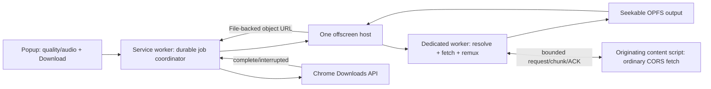

# Browser download architecture options

Research date: 2026-10-23. **Design recommendation, not an implemented downloader.** No package was installed, no media was downloaded by this research task, and no proprietary implementation was copied. Public documentation below was checked on this date; moving repository branches are not a substitute for a pinned release and artifact hashes during implementation.

## Evidence boundary

- **Verified locally:** the current manifest grants only `webRequest`, `webNavigation`, and `storage`; there is no download host, muxer, job model, or save API. `MediaItem` describes discoveries, not executable download plans. See [`extension/manifest.json`](../../../extension/manifest.json), [`src/core/model.ts`](../../../src/core/model.ts), and [`package.json`](../../../package.json).
- **Verified runtime:** the [ours-only state](../cinejoy-gap/final-standalone-state.json) contains the same HLS master as the original, duration **3189.561635 seconds**, 1920×1080 / 1280×720 choices, and no protection tag. The [new initialization plus first-segment probe](cinejoy-codec-probe.json) verifies **H.264 High 1920×1080 plus AAC-LC, 48 kHz stereo**, using installed ffprobe. This supports packet remux into MP4; it does not verify later segments or a full episode. The [incident report](../../CINEJOY_DETECTION_FIX.md) records page-context success versus extension-worker 404 and 797 preferred-rendition media segments plus an initialization map.
- **Verified prior static:** the [original investigation](../../REA_ANALYSIS.md#download-initiation-processing-and-completion) traces offscreen → dedicated worker → LibAV/OPFS → blob URL → Downloads API. That supports a browser-only architecture; it does not require a native companion. Original function names and flow are evidence, not reusable source.
- **Proposed below:** engine choice, binary transport, limits, lifecycle, and acceptance gates. These remain unverified until exercised in the actual unpacked extension.

## Recommendation

Use a **browser-only download subsystem** with a single offscreen host, a dedicated processing worker, disk-backed temporary files, and a durable job coordinator. First evaluate a pinned public Mediabunny release against the actual Cinejoy initialization/segment bytes. Keep the engine behind a small adapter so a licensed custom LibAV build can be added for unsupported demuxing without changing the UI or queue. A native helper is a later optional backend, not the default requirement for this target.

The diagram's page transport passes through extension runtime messaging and the offscreen host; it is not a direct transferable channel from a content script to the worker. Download state must distinguish `queued`, `resolving`, `fetching`, `muxing`, `saving`, `complete`, `canceled`, and `failed`. A returned object URL, a muxer progress of 1, or a `.mp4` filename is insufficient evidence of completion.

## Engine tradeoffs

| Option | Useful capabilities | Concrete limits / decision |
|---|---|---|
| **Mediabunny** | Public TypeScript HLS reader, fMP4/MPEG-TS demuxing, encoded packet IO, MP4 output, custom per-path sources, bounded caches and streaming targets. Verified release **1.62.1**, MPL-2.0. | Best initial candidate for clear HLS/direct remux. Its documented input formats do not include MPD; DASH requires our own segment resolver/track timeline integration. Quality/audio selection and timestamp behavior must pass fixtures and the full Cinejoy output. |
| **Custom LibAV.js/WASM** | FFmpeg demux/mux primitives, stream and block input devices, offset-aware writer callbacks; custom fragments can include HLS/MP4/TS and relevant parsers. | More build/configuration and license-distribution work. Public `jsfetch` is experimental and not in ordinary default builds, so original's bundled behavior cannot be assumed to exist in npm defaults. Package the JS/WASM locally; use devices backed by OPFS instead of whole-file MEMFS. |
| **Generic ffmpeg.wasm example pipeline** | Convenient command-based remux/transcode API. | The current FAQ states a **2 GB input limit**. Whole-file `writeFile` + `readFile` creates avoidable large memory pressure. Reject as the default architecture for this 53-minute target. |
| **Native FFmpeg helper** | Mature OS-file IO, broad format coverage, lower processing overhead. | Requires separate OS installation, native host registration and `nativeMessaging`; updates and cross-platform packaging become product obligations. It still needs the browser's working request context or an authorized byte relay. It does not automatically solve CDN authorization. |

Sources: [Mediabunny release](https://github.com/Vanilagy/mediabunny/releases/tag/v1.62.1), [versioned package metadata](https://raw.githubusercontent.com/Vanilagy/mediabunny/v1.62.1/package.json), [HLS reading](https://mediabunny.dev/guide/reading-hls), [supported formats/codecs](https://mediabunny.dev/guide/supported-formats-and-codecs), [LibAV IO](https://github.com/Yahweasel/libav.js/blob/master/docs/IO.md), [LibAV configuration](https://github.com/Yahweasel/libav.js/blob/master/docs/CONFIG.md), [ffmpeg.wasm FAQ](https://ffmpegwasm.netlify.app/docs/faq/), [Chrome native messaging](https://developer.chrome.com/docs/extensions/develop/concepts/native-messaging).

For Mediabunny, prefer explicit encoded-packet remux with selected video and audio tracks. Its convenience conversion API can automatically transcode or drop tracks; a replacement downloader must inspect utilized/discarded tracks and reject unintended video-only output. Remux should preserve compressed packets and require no decode/encode capability. [Conversion behavior](https://mediabunny.dev/guide/converting-media-files), [encoded packet sinks](https://mediabunny.dev/guide/media-sinks), [media sources and backpressure](https://mediabunny.dev/guide/media-sources).

### Concrete Mediabunny adapter boundary

Pin `mediabunny: "1.62.1"` and record package integrity/source/license notices when installation is authorized. Interfaces checked in the public API/source:

| Responsibility | Proposed public interfaces |
|---|---|
| Read selected Cinejoy rendition | `Input({ source, formats: HLS_FORMATS })`; `UrlSource(url, { fetchFn, maxCacheSize, parallelism, getRetryDelay })` using the bounded context-aware transport, or `CustomPathedSource` returning job-owned sources. |
| Select streams and retain codec setup | `input.getTracks()`; track `getCodec()` and `getDecoderConfig()`. Keep the exact selected video and its associated audio; validate dimensions and language. |
| Copy compressed media | `EncodedPacketSink(track).packets()` yields decode order; feed `EncodedVideoPacketSource('avc')` and `EncodedAudioPacketSource('aac')`. Supply each track's decoder configuration with its first `add`, await every `add`, and preserve timing/interleaving. |
| Write regular MP4 to disk | `Output({ format: new Mp4OutputFormat({ fastStart: false }), target: new StreamTarget(writable, { chunked: true, chunkSize: 1024 * 1024 }) })`. Add tracks, start, close sources, finalize. The writable must honor each `chunk.position`, handle partial OPFS writes and apply backpressure. |
| Abort/cleanup | Cancel the output and dispose the input; propagate physical fetch abort, close access handles, and remove partial job files once no consumer uses them. |

[Versioned track API](https://raw.githubusercontent.com/Vanilagy/mediabunny/v1.62.1/src/input-track.ts), [reading sources](https://mediabunny.dev/guide/reading-media-files), [packet sources](https://mediabunny.dev/guide/media-sources), [output target contract](https://mediabunny.dev/guide/writing-media-files).

**Selected-rendition detail:** point the Cinejoy input at the chosen **media playlist**, not the master. Its master lacks `CODECS`; the public HLS master reader probes each variant's underlying media to infer missing codecs. Using the selected media playlist avoids fetching 720p when the user selected 1080p. For masters with separate audio groups, resolve and retain the associated audio selection explicitly. [HLS master inference implementation](https://raw.githubusercontent.com/Vanilagy/mediabunny/v1.62.1/src/hls/hls-demuxer.ts).

## Request context and binary transport

The existing `fetch-manifest` endpoint intentionally permits only small UTF-8 text, a short absolute deadline, and a still-current originating document. Keep it for detection. Download transport needs a separate job-scoped protocol with binary chunk limits and a long-running lifecycle.

1. Try ordinary extension-origin fetching for each authorized job resource. For the known Cinejoy path, select the originating document's ordinary CORS fetch when worker context fails. Content scripts fetch as the page's origin even when extension host permissions exist; using an offscreen worker does not recreate that context. [Chrome network requests](https://developer.chrome.com/docs/extensions/develop/concepts/network-requests).
2. Bind a fetch capability to the selected source/job, tab, frame, and document. Allow only validated manifest-derived URLs/ranges, normal redirects and job retries. Do not expose an arbitrary page-triggered privileged URL fetcher or silently carry credentials/query parameters to unrelated origins.
3. Stream content-script bytes using bounded JSON-safe chunks over runtime ports. Chrome's runtime messages use JSON serialization, not transferable `ArrayBuffer`s. A practical initial design is ≤256 KiB raw bytes per base64 chunk, one acknowledged in-flight chunk per request, sequence/offset validation, aggregate queue limits and abort on disconnect. Base64 adds about one third to byte payload size; this is a proposed compatibility tradeoff to measure. Convert to `Uint8Array` in the offscreen host and transfer buffers through ordinary worker `postMessage`. [Chrome message serialization](https://developer.chrome.com/docs/extensions/develop/concepts/messaging#serialization).
4. ACK only after the downstream bounded consumer has accepted the chunk. Enforce per-resource byte limits, request and idle deadlines, a finite retry budget, status/range checks, physical abort, and stale-document fencing. The old 2 MiB manifest limit must not become a whole-video limit, and removing all limits is not a solution.
5. Page navigation/closure makes that transport unavailable. Preserve a truthful recoverable failure; retry against a newly authorized current document only after matching the source. A browser-only implementation should not promise that a page-dependent CDN job survives closing its page until a separate extension-origin context strategy is proven.

**Unknown:** normal page-context manifest success does not prove all 797 segments, initialization objects, byte ranges, redirects or signed URLs can be read over the same path. Measure this in the actual extension. Do not add broad header rewriting, disable web security, or claim it is necessary without a focused server/request-context test.

## Long-video memory and disk constraints

The declared 1080p bandwidth gives `5,022,000 × 3189.561635 / 8 ≈ 2,002,247,316` bytes (**1.86 GiB**); 720p gives approximately **1.014 GB**. These are bandwidth-based estimates, not measured content lengths. This makes an all-input/all-output-in-RAM implementation unsuitable even if one nominal input barely fits a library limit.

- Write output directly to OPFS at supplied byte offsets. A dedicated worker can use a synchronous access handle; check short writes, flush, and close it before obtaining the final `File`. OPFS is temporary origin-private storage, not the user's Downloads file. [OPFS worker/file APIs](https://web.dev/articles/origin-private-file-system).
- Use bounded network chunks/caches and a small number of concurrent segment fetches. Feed interleaved video/audio packets with awaited backpressure; downloading an entire video track while buffering a later audio track defeats memory bounds. This is an application requirement, not a claim that any library enforces our chosen global cap.
- For a regular seekable MP4, use a seekable target and tail metadata (`fastStart: false`) initially. Mediabunny's `fastStart: 'in-memory'` retains media chunks until finalization. Fragmented MP4 can stream with lower metadata costs, but player/seeking compatibility must be verified before making it the default. [MP4 output options](https://mediabunny.dev/guide/output-formats).
- Mediabunny `StreamTarget` chunks may overwrite earlier offsets; simply concatenating emitted chunks can corrupt the result. Its target supports downstream backpressure. [Output targets](https://mediabunny.dev/guide/writing-media-files#streamtarget).
- Request `unlimitedStorage` for large extension-origin work and still check available estimates, disk-full errors, cancellation cleanup and orphan cleanup. Chrome documents that this permission removes normal extension/web-storage quota and eviction constraints; it does not create physical disk space. [Extension storage behavior](https://developer.chrome.com/docs/extensions/develop/concepts/storage-and-cookies).
- A one-pass remux plus browser save can temporarily need roughly **two final-file sizes** on disk: OPFS output and the browser's destination. Keeping all source segments for retry/resume raises this toward **three sizes**. Estimates need margin for container overhead and simultaneous jobs. Persisting source segments allows remux restart after a process crash; recovering arbitrary partially written mux state is a separate unproven feature.

## Chrome integration and permissions

Add **`offscreen`** and **`downloads`**; use **`unlimitedStorage`** for the large disk-backed design. Existing host permissions already cover HTTP(S) resources. No `nativeMessaging`, `cookies`, `scripting`, DNR, notifications, or `downloads.open` permission is required by the proposed first browser-only path.

An offscreen document is a bundled static page; an installed extension normally has one. Use the `WORKERS` and `BLOBS` reasons. It can use web APIs and extension runtime messaging, while the service worker owns Downloads API calls. Creation must be idempotent and compatible with the manifest's Chrome 120 minimum; do not depend unconditionally on recently added `offscreen.hasDocument()`. [Offscreen API](https://developer.chrome.com/docs/extensions/reference/api/offscreen).

The service worker must persist job identity/selection/progress and reconnect to the live host rather than restart a duplicate transfer after suspension. In-memory globals do not survive worker termination. [Service worker lifecycle](https://developer.chrome.com/docs/extensions/develop/concepts/service-workers/lifecycle).

Mediabunny's pure TypeScript remux path can keep the current CSP. If LibAV/WASM is selected, add `'wasm-unsafe-eval'` to `script-src`, bundle every executable dependency locally, and inspect the exact build. [Chrome extension CSP](https://developer.chrome.com/docs/extensions/reference/manifest/content-security-policy).

Create a file-backed object URL only after finalization/close, then ask the service worker to call `downloads.download`. Persist its returned download ID and wait for the matching complete/interrupted event. Retain the file and its object URL until that browser stage terminates; clean up afterward. The API's promise means the download started, not that a usable file has been saved. Direct HTTP download calls include cookies and restricted custom headers, so they are a useful fast path only when the actual source works in that request context. [Downloads API](https://developer.chrome.com/docs/extensions/reference/api/downloads).

## Coverage required beyond the first Cinejoy file

- Direct MP4/WebM: preserve actual container/extension on the ordinary transfer path; use the remux path only for an explicitly supported output conversion.
- HLS: selected video/audio groups, multiplexed versus separate audio, initialization maps, byte ranges, sequence numbers, discontinuities/timestamp normalization and refresh for live streams. The current detection parser records enough for grouping but not a complete executable download plan. Start with clear VOD; explicitly reject unsupported constructs while adding them, without treating the whole replacement goal as complete.
- DASH: fully expand the selected representation's finite segment schedule, initialization and ranges with BaseURL inheritance, Number/Time templates and SegmentTimeline; retain Period/presentation timing and audio selection. The current detector's wildcard relationships are not a download schedule. Feed selected fMP4/TS data to the shared packet/mux engine, or use a separately verified LibAV DASH backend. MPD support is not established merely because a library accepts fMP4 segments.
- Keep protected/DRM media truthfully unavailable. Clear-source success and encryption-tag detection are different claims. No commercial-CDM key extraction is part of this design.

## Full-output acceptance gates

1. Independently owned generated fixtures: direct MP4/WebM; HLS fMP4/TS, separate audio, range, discontinuity; DASH Number/Timeline/List/finite Period cases. Verify bytes on direct transfers, packet/timing invariants on remux, and no wrong-quality or missing-audio success.
2. Use the actual toolbar Download action through a Chrome download to a controlled output directory. Record chosen source/quality/audio, engine/library version, hashes, byte/segment counts, browser download ID/state and final file identity. Unit mux output alone is insufficient.
3. Inspect the entire **saved** Cinejoy file: container MP4, selected dimensions, actual video/audio streams, duration near 3189.56 seconds with a declared packet-duration tolerance, and playable first/middle/end seeks. Run full-file `ffprobe` packet counting and a full decoder pass with local FFmpeg; metadata-only probing or a short preview does not prove the 53-minute output. [Official ffprobe options](https://www.ffmpeg.org/ffprobe.html).
4. Monitor browser process memory and disk across the full output; verify bounded transport queues and no memory growth proportional to all downloaded bytes. Include a generated >2 GB file and a long-duration fixture so a passing 6-second example cannot establish long-video support.
5. Cancel during fetch, mux and browser save; close popup; terminate/restart the service worker; navigate/close the owning page; inject segment failure, expiry, truncated/range mismatch, disk-full and browser download interruption. Verify physical cancellation, truthful state, retry behavior, no duplicate jobs and eventual OPFS/object-URL cleanup.

Licensing must be checked for the exact artifacts chosen: Mediabunny is MPL-2.0 with source-file obligations for modifications; LibAV's wrapper is 0BSD while bundled FFmpeg/libraries carry their own notices and source obligations. FFmpeg's license depends on enabled optional components. This is artifact provenance work; the original extension's library bundle must not be copied. [Mediabunny license](https://github.com/Vanilagy/mediabunny), [LibAV licensing](https://github.com/Yahweasel/libav.js/blob/master/README.md), [FFmpeg license/build options](https://ffmpeg.org/legal.html).
