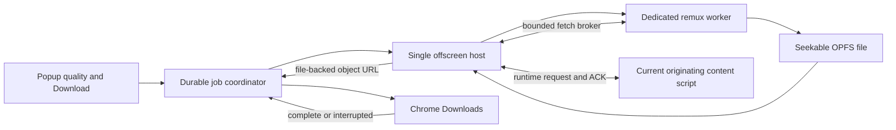

# Proposed browser download subsystem

Date: 2026-10-23. **Status: proposed, awaiting architectural approval. No production download code or new dependency is installed.**

## Outcome and scope

Make the pictured Cinejoy source usable: choose 1080p or 720p, click Download, and obtain a real MP4 with video/audio and the full 53:10 duration. Keep the existing detector and its provenance. Preserve the distinction between an HLS source and an MP4 output.

This is the first download subsystem in the repository, not a popup-only edit. It must deliver the full Cinejoy file before its acceptance is declared. Broader replacement coverage remains explicit: direct files, independent HLS layouts and DASH require their own adapters and final-file tests; worldwide Video DownloadHelper equivalence is not an acceptance claim. YouTube is excluded by the user's clarification.

Supporting investigation: [DOWNLOAD_REPLACEMENT_GAPS.md](../../DOWNLOAD_REPLACEMENT_GAPS.md). Exact original references are research evidence, not source to copy.

## Approach selection

| Approach | Benefit | Tradeoff |
| --- | --- | --- |
| **Browser-only TypeScript remux, recommended** | Fits the confirmed H.264/AAC Cinejoy source; no installer, native host or WASM CSP change. Disk-backed output handles long media. | Prove the pinned library with actual bytes, timing, bounded IO and final files. DASH needs an independent planner. |
| Browser-only custom LibAV/WASM | Broader demuxers and close architectural correspondence to the inspected original | More package/build/license work and WASM CSP; stock examples must not buffer full videos in RAM. |
| Native FFmpeg helper | Mature streaming file IO and format support | Adds an installed component, native host registration and platform maintenance; still needs an authorized request-context solution. |

Select the first approach with a small engine adapter. If the exact source fails a meaningful remux proof, stop and evaluate the failure against the other approaches; do not silently transcode, discard audio or substitute a preview.

## Components and boundaries

Proposed files extend the current structure:

| Path | Responsibility |
| --- | --- |
| `src/downloads/model.ts`, `validation.ts` | Versioned job/selection/plan/event contracts and strict message validation. |
| `src/downloads/store.ts`, `coordinator.ts` | Serialized durable metadata, idempotent starts, host reconciliation, browser download IDs and terminal transitions. |
| `src/downloads/plan.ts`, `hls-plan.ts` | Resolve a selected source/rendition/audio association; preserve URLs and declared ranges; reject unsupported plans explicitly. |
| `src/downloads/transport.ts`, `src/content/download-fetch.ts` | Independent bounded binary transport, normal-CORS fallback, ACK/backpressure, cancellation and document fences. |
| `src/downloads/offscreen.ts`, `offscreen.html` | One host, worker messages, file-backed object URL lifetime, and service-worker reconnection. |
| `src/downloads/worker.ts`, `remux.ts`, `opfs.ts` | Pinned public media library adapter, packet copying, seek-aware disk output and cleanup. |
| Existing background/content entry points | Register small download routing hooks without rewriting detection. |
| Existing popup view/controller/style | Quality, filename, Download, phase/progress, cancel/retry and saved/error outcomes. Keep diagnostic details expandable. |
| Manifest/build/third-party notices | New permissions, extra local entry points, licensed dependency and audited artifact allowlist. |
| Focused unit and native browser tests | Contracts/races, generated media fixtures, actual Download action and saved-file validation. |

These are proposed boundaries; implementation can combine tiny adjacent units without changing their responsibilities or moving unrelated existing code.

## Job and selection contract

A job snapshots its own ID, request ID, source/candidate ID and instance, tab/generation/document provenance, source URL, selected rendition and associated audio, sanitized filename/output type, timestamps, phase, known byte/time progress, temporary file identity, browser download ID and structured error. Page strings never choose a filesystem path. URLs retain byte-significant signed queries.

Only a trusted extension page can request a start/cancel/retry. Start checks that the selected confirmed source and rendition still match the snapshot. A repeated click with the same request ID returns the existing job. A different active request for the same source/selection is surfaced instead of silently duplicating work. Metadata is saved before execution is acknowledged.

Lifecycle: `queued → resolving → processing → ready-to-save → saving → complete`, with distinct `failed`, `canceled` and `interrupted` outcomes. Fetching/remuxing progress can be interleaved within processing. Completion requires the matching Chrome download to complete. A muxer reaching its last packet or returning a blob is not completion.

Download metadata uses a separate versioned local-storage key; it does not inflate detection snapshots with media bytes. Keep at most 50 recent terminal records and two queued jobs, initially one processing job at a time. Progress is throttled; durable checkpoints do not occur for every packet. Restart recovery queries the existing offscreen host before starting anything. A lost processing worker/process is interrupted, not falsely completed or resumed from an arbitrary byte offset.

## Media planning and IO

For Cinejoy, resolve the exact selected media-playlist URL from the confirmed master. Pass that selected playlist to the media engine. Its master has no CODECS field; using the master as a generic library input could probe every rendition. The sample has embedded audio, so retain both actual tracks. Separate-audio fixtures must prove explicit association; never borrow audio from another tab source.

Do not weaken the detection manifest endpoint. Use a job-scoped binary broker. Try ordinary extension-origin IO; when required, fetch through a current originating content-script document under normal CORS/default same-origin credentials. No broad header rewriting or copying cookies/authorization values is proposed. Validate the job/source-derived URL and range before requests, and revalidate document identity around fallback replies.

Initial transport bounds: four active resource fetches globally, one unacknowledged chunk per request, 256 KiB raw bytes per chunk, an 8 MiB aggregate queue budget, and a bounded 32 MiB input cache. Manifest text remains capped at two MiB; ordinary media resources are capped at 64 MiB per bounded read/range, with larger resources served through validated ranges rather than loading an entire file. Use finite request/idle deadlines and at most three attempts for retryable transport failure. Response status, ranges, sequence/offset and redirects are validated. The engine adapter must expose backpressure rather than accumulate unresolved read requests. These bounds need native verification and may be tuned from measured evidence.

Chrome runtime messaging uses JSON, so page fallback carries bounded base64 chunks, request/sequence/offset IDs and ACK/cancel. The offscreen host converts chunks and transfers their buffers to the worker. ACK only after downstream acceptance. Port disconnect, user cancel, stale document and timeout physically abort requests and release queues. A stale response must never enter a replacement job.

Page closure/navigation is a separate boundary from popup closure. If a resource needs the page transport after that document disappears, fail recoverably and preserve an honest reason. No claim of page-independent continuation is made without a separate working request-context test. The selected Cinejoy output must finish with its authorized page available; popup closure and real service-worker restart must also pass.

## Processing and storage

Pin public `mediabunny` **1.62.1**, MPL-2.0, with package integrity and notices. Bundle executable code locally. No original extension source, library binary, site rule or private protocol is copied.

Use `Input`/`HLS_FORMATS` and selected-media sources. Read actual track codec/configuration. Copy compressed packets through `EncodedPacketSink` and encoded video/audio sources; preserve decode order, timestamp relationships, configuration changes and bounded interleaving. Do not use an automatic conversion mode that may drop audio or silently transcode. Unsupported codec/timestamp structures produce an explicit failure.

Use a regular `Mp4OutputFormat` with `fastStart: false` and a seek-aware `StreamTarget` backed by an OPFS synchronous access handle in the dedicated worker. Honor output positions and short writes; await downstream operations. Do not concatenate output chunks blindly or retain the full video in a BufferTarget. Finalize, flush and close all handles before obtaining the File and object URL. Verify output tracks, dimensions and duration before the save stage.

Check storage estimates before starting and surface quota/disk errors. Request `unlimitedStorage` to avoid normal extension-origin storage quota/eviction limits, while still handling physical disk limits. The declared 1080p bitrate estimates about 2.0 GB of media; this is not a measured final size. Temporary OPFS plus the browser's saved file can need roughly two output sizes with margin. Do not retain every source fragment solely to simulate resume.

Keep the temporary file/object URL alive through Chrome saving. Terminal browser events trigger cleanup; interrupted saves may retain a bounded ready file for an explicit retry. Startup reconciles orphan files/jobs. Cancellation removes partial files after active writers/readers close. Cleanup failure is recorded and retried; no complete state is invented to hide it.

## Product and permissions

The primary card shows title/filename, source HLS, output MP4, a real 1080p/720p selector and Download. During a job it shows phase, meaningful bytes/time/percentage when known, cancel and actionable failure/retry state. Closing the popup does not cancel. Copy URL and low-level source details remain secondary. A disabled Download must explain the actual unsupported source/selection.

Add `downloads`, `offscreen`, and `unlimitedStorage` to the current three API permissions. Use one bundled offscreen page with `WORKERS`/`BLOBS`, created idempotently using Chrome-120-compatible APIs. The service worker owns Downloads API calls; the host owns blob lifetime. No native helper, `scripting`, DNR, cookie API, DRM workflow or WASM CSP change is part of this proposal.

MPL source/license obligations and the existing XML parser license must remain satisfied by the actual bundle. Extend the build allowlist only for the selected local pages/workers/notices; research receipts, sample media, tests and source maps remain outside `dist`.

## Required acceptance evidence

1. RED-to-GREEN focused tests for selection, audio association, safe naming, duplicate starts, invalid/stale messages, actual transport cancellation, bounded queues/partial reads, offset writes, persistence, host reconnection and browser completion/interruption.
2. Generated H.264/AAC HLS fMP4 and MPEG-TS fixtures, both qualities and separate audio; relevant map/range/discontinuity cases. Verify actual saved MP4 streams, dimensions, duration and seekability. Preserve negative/protected-source behavior and existing detection tests.
3. Through the actual toolbar, download the **entire selected Cinejoy 1080p episode** to a controlled local directory. Verify Chrome complete state and saved file identity. Record engine/build/version/hash, chosen source, exact segment/byte accounting and output path; media files stay outside Git/build.
4. Independently inspect the full saved file with installed ffprobe and run a full decoder pass with installed FFmpeg as test tools. Expect H.264 1920×1080 plus audible AAC stereo, duration near 3189.56 seconds within a declared two-second packet/container tolerance. First/middle/end playback and seeking must work. A short sample or metadata-only result cannot satisfy this gate.
5. Exercise 720p and deterministic quality/audio controls; no unsolicited other-rendition fetches. Observe memory/disk/queues through the full output, plus a generated >2 GB control. Memory must not grow with all downloaded payload bytes.
6. Close the popup, stop/wake the real service worker, cancel during processing/save, inject a segment failure/expiry/range mismatch, and interrupt Chrome saving. Check truthful terminal states, no duplicate jobs, physical cancellation, cleanup and retry. Record page-navigation/closure behavior explicitly rather than equating it to popup closure.
7. Run typecheck, the complete relevant regression suite, the audited build and final scoped code review. Re-run live acceptance on the frozen artifact, with exact hashes and all blocked/unverified cases labeled.

The library/runtime, full episode and failure gates are not yet passing evidence. Approval authorizes implementing this design; completion still requires those actual results. Any broader replacement capability not exercised remains an explicit gap.
